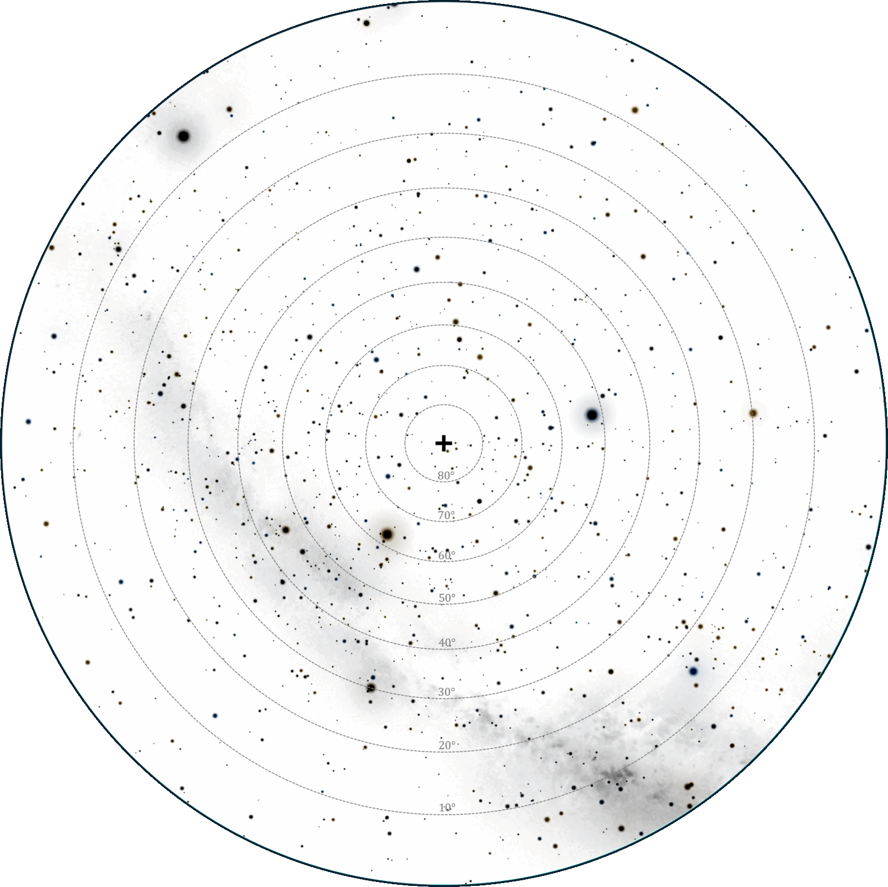
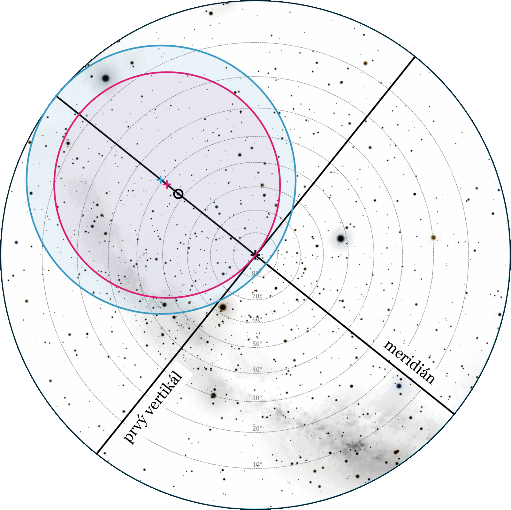

## Zadanie

Jednou z hlavných kružníc v sústave horizontálnych súradníc je prvý vertikál. Prvý vertikál je hlavná kružnica, ktorá spája zenit, nadir, východný a západný bod horizontu. Priložená mapa bola vytvorená pre Nitru, ktorá má zemepisné súradnice $48^{\circ}\,18'$ N, $18^{\circ}\,5'$ E. Na mape je krížikom vyznačený zenit ako pomôcka.

<ol type="a">

<li>

[10 b] Do mapy zakreslite meridián a prvý vertikál.

</li>

</ol>

Nájdite hviezdy pozorovateľné z Nitry, ktoré nikdy nepretnú prvý vertikál a

<ol type="a" start="2">

<li>

[15 b] vypočítajte rozsah ich deklinácií,

</li>

<li>

[25 b] na priloženej mape vyznačte oblasť, v ktorej sa nachádzajú.

</li>

</ol>

Nájdite cirkumpolárne hviezdy pre Nitru a

<ol type="a" start="4">

<li>

[15 b] vypočítajte rozsah ich deklinácií,

</li>

<li>

[25 b] na priloženej mape vyznačte oblasť, v ktorej sa nachádzajú.

</li>

</ol>

V poslednej podúlohe tieto časti porovnajte.

<ol type="a" start="6">

<li>

[10 b] Nájdite miesta na severnej pologuli Zeme, kde je oblasť oblohy z častí (b) a (c) zhodná s oblasťou oblohy z častí (d) a (e). Uvažujte uvedené časti oblohy vzhľadom na dané miesta na Zemi, nie vzhľadom na Nitru.

</li>

</ol>

*Nápoveda: Priložená mapa je vytvorená v stereografickej projekcii. V tejto projekcii sa hlavné aj vedľajšie kružnice na sfére zobrazujú stále ako kružnice, ale ich stred nemusí ležať tam, kde by sme ho mohli naivne očakávať. Na mape sú ako pomôcka vyobrazené almukantaráty (kružnice spájajúce body s rovnakou výškou nad obzorom) s rozostupom $10^{\circ}$.*

<figure>

<figcaption>

**Obrázok 1:** Mapa celej oblohy v stereografickej projekcii vytvorená pre Nitru. Na mape je ako pomôcka zenit vyznačený krížikom. Na mape sú taktiež vyznačené almukantaráty s rozostupmi $10^{\circ}$. Zdroj podkladovej mapy: Stellarium.
</figcaption>

</figure>

Riešenie

<ol type="a">

<li>

Meridián je hlavná kružnica, ktorá prechádza zenitom, nadirom, svetovými pólmi a severným a južným bodom horizontu. V projekcii priloženej mapy bude hlavná kružnica prechádzajúca zenitom zobrazená ako časť priamky. Na nájdenie meridiánu nám stačí spojiť zenit a severný svetový pól (s dobrou presnosťou Polárku). Meridián je vyobrazený na obrázku 2.[5 b]

Z definície v zadaní možno usúdiť, že prvý vertikál je kolmý na meridián. Priesečník prvého vertikálu a meridiánu je v zenite, pričom prvý vertikál prechádza cez východ a západ a meridián cez sever a juh. Prvý vertikál je zobrazený na obrázku 2.[5 b]

</li>

<li>

Hľadaná oblasť oblohy musí byť symetrická okolo svetového pólu, čo znamená, že na sfére pôjde o kružnicu so stredom v svetovom póle a polomer musí byť zhodný so vzdialenosťou pólu a najbližšieho bodu prvého vertikálu.[5 b] Vidíme, že najbližší bod k pólu, ležiaci na prvom vertikále, je zenit.[3 b]

Polomer kružnice, ktorú hviezda opisuje pri pohybe okolo svetového pólu, je všeobecne daný ako $r = 90^{\circ} - \delta$. Maximálny polomer kružnice, ktorú hľadáme, je rovný zenitovej vzdialenosti pólu $z_P = 90^{\circ} - \varphi$. Pre všetky hľadané hviezdy teda platí 

$$
90^{\circ} - \delta \leq 90^{\circ} - \varphi\,, \qquad\textit{[4\,b]} \tag{1}
$$

 odkiaľ po úprave dostaneme 

$$
\boxed{\delta \geq \varphi = 48^{\circ}\,18'}\,. \qquad\textit{[3\,b]} \tag{2}
$$

</li>

<li>

Z nápovedy zo zadania vieme, že sa stredy projektovaných kružníc nebudú zhodovať s miestami, na ktoré sa zobrazia pri tejto projekcii stredy reálnych kružníc. Zároveň na priloženej mape v zadaní vidíme, že almukantaráty sú smerom k zenitu bližšie k sebe. Stred projektovanej kružnice musí byť opäť na meridiáne.[5 b] Na základe rovnice (1) z predošlého zadania vieme, že polomer tejto kružnice je $r = 90^{\circ} - \varphi$, a teda priemer je $d = 2 \cdot (90^{\circ} - \varphi) = 83^{\circ}\,23'$.[5 b] Jedným okrajom tejto kružnice je podľa predošlých úvah zenit a druhý okraj bude vzdialený o $d$ od zenitu smerom na sever po meridiáne, pričom túto vzdialenosť odhadneme podľa zobrazených almukantarátov.[5 b] Následne presne v strede medzi týmito bodmi bude stred hľadanej kružnice, ktorý je vyobrazený na obrázku 2 ružovým krížikom. Polomer je vzdialenosť k jednému krajnému bodu. Kružnica je vyobrazená ružovou farbou na obrázku 2.[10 b]

*Poznámka: Ak by sme uvažovali aj hviezdy nepozorovateľné z Nitry, tak ďalším riešením by bola oblasť okolo južného pólu symetrická s tou, ktorú sme našli okolo severného pólu, teda rozsah deklinácií 

$$
\delta \leq \varphi = -48^{\circ}\,18'\,. \tag{3}
$$

*

</li>

<li>

Využijeme obdobný postup ako v (b), ale v tomto prípade je maximálny polomer kružnice rovný vzdialenosti pólu a horizontu, teda výške svetového pólu $h_p = \varphi$.[8 b] Môžeme teda písať nerovnosť 

$$
90^{\circ} - \delta \leq \varphi \qquad\textit{[4\,b]}\,, \tag{4}
$$

 odkiaľ dostaneme rozsah deklinácií ako 

$$
\boxed{\delta \geq 90^{\circ} - \varphi = 41^{\circ}\,42'}\,.\qquad\textit{[3\,b]} \tag{5}
$$

</li>

<li>

Pri hľadaní kružnice na mape využijeme obdobný postup ako v časti (b). Polomer kružnice podľa rovnice (4) je $r = \varphi$, a teda priemer kružnice $d = 2 \varphi = 96^{\circ}\,36'$.[10 b] Z predchádzajúcich úvah je jasné, že jedným okrajom tejto kružnice je severný bod horizontu a druhý okraj bude vzdialený o $d$ smerom na juh po meridiáne, pričom vzdialenosť môžeme opäť odhadnúť pomocou vyobrazených almukantarátov. Stred sa bude nachádzať presne medzi týmito dvomi bodmi (je vyznačený modrým [5 b] krížikom) a polomer je vzdialenosť k jednému z okrajov. Kružnica je vyobrazená na obrázku 2 modrou farbou.[10 b]

</li>

<li>

Z úvahy aj z výpočtu vieme, že na skutočnej oblohe sú obe tieto oblasti ohraničené kružnicami so stredom v severnom svetovom póle.[3 b] Nerovnice (5) a (2) nám určujú príslušné rozsahy deklinácií. V prípade, že $\varphi = 45^{\circ}$, budú oba rozsahy deklinácií zhodné, nakoľko svetový pól bude presne medzi zenitom a horizontom.[7 b]

<figure>

<figcaption>

**Obrázok 2:** Mapa celej oblohy vytvorená pre Nitru. Riešenie s vyznačeným meridiánom a prvým vertikálom. Hviezdy, ktoré nepretnú prvý vertikál – ružová kružnica (b); cirkumpolárna časť oblohy – modrá kružnica (c). Zdroj podkladovej mapy: Stellarium.
</figcaption>

</figure>

</li>

</ol>

