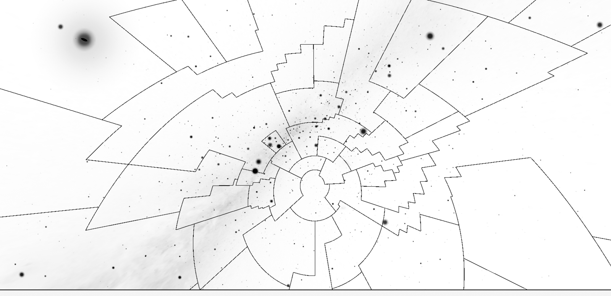
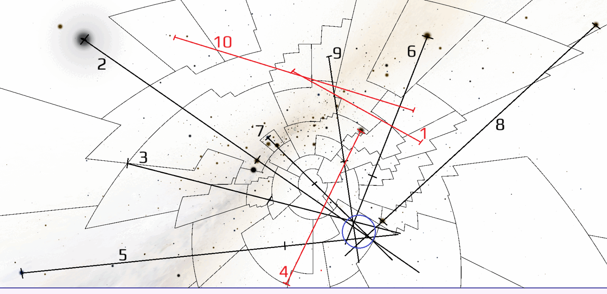

## Zadanie

Astronóm nachádzajúci sa niekde na južnej pologuli pozoroval meteorický roj. Nemal pri sebe mapu, do ktorej by zakresľoval stopy meteorov, a tak si aspoň zapísal, odkiaľ kam sa zhruba pohybovali na oblohe. Na ďalší deň si zakreslil ich trajektórie do mapy v gnómonickej projekcii a zistil, že objavil nový meteorický roj. Vašou úlohou je zopakovať jeho postup, nájsť radiant tohto nového roja a určiť súhvezdie, v ktorom sa nachádza.

Do priloženej mapy zakreslite trajektórie všetkých 10 meteorov a označte ich príslušným číslom. Tri z desiatich meteorov sú sporadické. Určite, ktoré z nich to sú. Do mapy zakreslite oblasť, v ktorej sa nachádza radiant roja, a napíšte slovenský názov a latinskú skratku súhvezdia, v ktorom sa radiant nachádza.

Pozorované meteory:

<ol type="a">

<li>

Zo stredu súhvezdia Rydlo do stredu súhvezdia Výveva.

</li>

<li>

Od hviezdy Beta Cen k Mesiacu.

</li>

<li>

Od hviezdy Atria k miestu, kde sa stretávajú hranice súhvezdí Vlk, Centaurus, Hydra a Váhy.

</li>

<li>

Od hviezdy Canopus k hviezde Peacock.

</li>

<li>

Od stredu súhvezdia Páv cez súhvezdie Oltár až k hviezde Antares.

</li>

<li>

Zo stredu súhvezdia Sieť smerom k hviezde Sírius.

</li>

<li>

Od svetového pólu k hviezde Gamma Cru.

</li>

<li>

Od hviezdy Achernar k hviezde Rigel.

</li>

<li>

Od Malého Magellanovho mraku až do stredu súhvezdia Kompas.

</li>

<li>

Zo stredu súhvezdia Havran k hviezde Alpha Col.

</li>

</ol>

*Nápoveda: V gnómonickej projekcii sa všetky hlavné kružnice zobrazujú ako priamky. Meteory sa na oblohe zdanlivo pohybujú po oblúkoch hlavných kružníc. Stopy meteorov preto môžeme do tejto mapy zakresliť ako úsečky.*

<figure>

<figcaption>

**Obrázok 1:** Mapa v gnómonickej projekcii na zakresľovanie stôp meteorov. Zdroj: Stellarium
</figcaption>

</figure>

Riešenie

Stopy meteorov predĺžime smerom dozadu k oblasti, z ktorej vyleteli. Zakreslené to je na obrázku 2. Vidíme, že meteory číslo 1, 4 a 10 zdanlivo vyletujú z úplne iných miest na oblohe ako zvyšných 7 meteorov. Z toho môžeme usúdiť, že práve tieto 3 meteory sú sporadické (na mape sú preto vyznačené červenou farbou). Stopy zvyšných meteorov vychádzajú z rovnakej oblasti označenej modrou kružnicou, v jej vnútri sa teda nachádza radiant roja.

<figure>

<figcaption>

**Obrázok 2:** Mapa so zakreslenými stopami meteorov a vyznačenou oblasťou, v ktorej sa nachádza radiant.
</figcaption>

</figure>

Keďže trajektórie meteorov sú len približné, ich stopy sa nepretínajú presne v jednom bode. Radiant môžeme umiestniť zhruba do ťažiska bodov, v ktorých sa stopy rojových meteorov pretínajú. Nachádza sa v súhvezdí Tukan (lat. skratka Tuc).

*Poznámka k bodovaniu: Za každý správne nájdený začiatočný alebo koncový bod trajektórie bolo možné získať 4 b; za nájdenie oblasti, kde sa nachádza radiant 4 b; za slovenský názov a latinskú skratku súhvezdia radiantu 2 b + 2 b a za identifikáciu sporadických meteorov taktiež po 4 b.*

