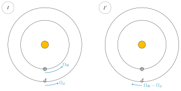
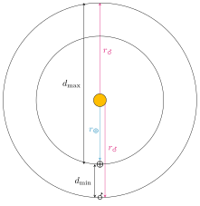
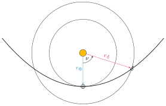

## Zadanie

Píše sa rok 2230. Ľudstvo úspešne osídlilo Mars a oslavuje dvojsté výročie pristátia prvého človeka na jeho povrchu. Na oslavu tohto úžasného vedeckého míľnika sa politici na Zemi rozhodli pripraviť pre obyvateľov Marsu prekvapenie – špeciálny dar, ktorý im doručí raketa vyslaná zo Zeme. V celej úlohe uvažujte iba gravitačný vplyv Slnka (teda zanedbajte gravitačný vplyv planét) a takisto uvažujte kruhové trajektórie Zeme a Marsu.

<ol type="a">

<li>

[14 b] Ako často sa zo Zeme naskytá výhodná príležitosť letu na Mars? Inými slovami, vypočítajte synodickú obežnú dobu medzi dvomi po sebe idúcimi opozíciami Marsu.

</li>

<li>

[12 b] Aká je najkratšia $\tau_{min}$ a aká je najdlhšia $\tau_{max}$ doba odozvy (tzv. *latencia*, ľudovo nazývaná „ping“) pri prenose informácie medzi Zemou a Marsom? Definujeme ju ako čas, za ktorý sa nám po odoslaní správy vráti odpoveď. Predpokladajte, že sa informácia prenáša prostredníctvom elektromagnetických vĺn vo vákuu rýchlosťou svetla.

</li>

</ol>

Aby však akcia zostala v tajnosti, oficiálne sa raketa tvári ako „obyčajná“ vedecká misia určená na prieskum hlbokého vesmíru. V skutočnosti však pri Marse vypustí pamätný balík.

<ol type="a" start="3">

<li>

[10 b] Vypočítajte najmenšiu rýchlosť rakety $v_p$ potrebnú na to, aby sa dostala zo vzdialenosti $r_p=1\,\mathrm{au}$ od Slnka do nekonečna.

</li>

<li>

[12 b] Určte obežnú rýchlosť Zeme $v_\Ea$. O akú rýchlosť $v_\Delta$ musí raketa zrýchliť, ak úplne využije obežnú rýchlosť Zeme? Pripomíname zanedbanie gravitačného vplyvu Zeme.

</li>

</ol>

Raketa sa bude pohybovať po parabolickej trajektórii, pre ktorú platí Barkerova rovnica v *konštantovníku*. Ide o závislosť času $t$ od pravej anomálie $\nu$, pričom $t_0$ predstavuje čas prechodu pericentrom. Parameter $p$ je takzvaný *semi-latus rectum*, ktorý viete určiť pomocou jeho geometrického významu na obrázku 1 alebo pomocou jeho vyjadrenia cez moment hybnosti $L$, ktoré takisto nájdete v *konštantovníku*. Takisto sa vám môže hodiť všeobecná rovnica kužeľosečky v polárnych súradniciach (vzdialenosť $r$, pravá anomália $\nu$).

<ol type="a" start="5">

<li>

[40 b] Upravte polárnu rovnicu kužeľosečky z *konštantovníka* tak, aby bola vzdialenosť $r$ vyjadrená iba pomocou $r_p$, $\nu$ a základných fyzikálnych konštánt. Obdobne upravte Barkerovu rovnicu pre parabolu tak, aby bol čas $t - t_0$ vyjadrený iba pomocou $\nu$, siderickej periódy Zeme $P_\Ea$ a základných fyzikálnych konštánt.

</li>

<li>

[22 b] Vypočítajte, za koľko dní od štartu na Zemi pretne raketa orbitu Marsu.

</li>

</ol>

<figure>

<figcaption>

**Obrázok 1:** Schéma parabolickej dráhy s ohniskom v Slnku a pericentrom $r_P = 1\,\mathrm{au}$. Čiernou bodkou je znázornená raketa vo vzdialenosti $r$ od Slnka s pravou anomáliou $\nu$.
</figcaption>

</figure>

Riešenie

<ol type="a">

<li>

Zem a Mars obiehajú v tom istom smere okolo spoločného stredu – Slnka. Synodická doba je preto čas, za ktorý vo vzťažnej sústave rotujúcej obehovou uhlovou rýchlosťou Zeme $\Omega_\Ea$ a stredom rotácie v Slnku urobí Mars jeden obeh po svojej orbite (obr. 2). Z toho pre uhlovú rýchlosť Marsu vo vzťažnej sústave $I'$ platí 

$$
\Omega_\Ma' = \Omega_\Ma - \Omega_\Ea = \frac{2\pi}{P_\Ma} - \frac{2\pi}{P_\Ea}\,,\qquad\textit{[7\,b]} \tag{1}
$$

 kde $P_\Ea$ je siderická perióda Zeme a $P_\Ma$ je siderická perióda Marsu. Tú vypočítame podľa 3. Keplerovho zákona pre veľkú polos v astronomických jednotkách a periódu v rokoch 

$$
\frac{a_\Ma^3}{P_\Ma^2} = \frac{a_\Ea^3}{P_\Ea^2} \ztv P_\Ma = P_\Ea \left(\frac{a_\Ma}{a_\Ea}\right)^{\frac32} \doteq 687{,}2\,\mathrm{dní} \,. \qquad\textit{[4\,b]} \tag{2}
$$

Mars urobí jeden obeh, teda uhol $2\pi$, za čas 

$$
P_{syn} = \frac{2\pi}{\Omega_\Ma'} = \frac{1}{\frac{1}{P_\Ma} - \frac{1}{P_\Ea}}\doteq\boxed{-779{,}7\,\mathrm{dní}}\,.\qquad\textit{[3\,b]} \tag{3}
$$

 Záporné znamienko hovorí o tom, že Zem má vyššiu uhlovú rýchlosť ako Mars, a teda pohyb vo vzťažnej sústave $I'$ bude v opačnom smere, tak ako sme to zakreslili.

Alternatívne sa na to vieme pozerať tak, že hľadáme čas $P_{syn}$, za ktorý Zem (keďže má vyššiu uhlovú rýchlosť) urobí o jeden celý obeh $2\pi$ viac ako Mars v bežne uvažovanej vzťažnej sústave $I$. To vedie ku vzťahu 

$$
\Omega_\Ma P_{syn} + 2\pi = \Omega_\Ea P_{syn}\,, \tag{4}
$$

 z ktorého dostaneme po úpravách ten istý výsledok.

<figure>

<figcaption>

**Obrázok 2:** Vzťažná sústava $I$ a $I'$. Veľkosť uhlovej rýchlosti Marsu je menšia ako veľkosť uhlovej rýchlosti Zeme, preto bude Mars vo vzťažnej sústave $I'$ obiehať okolo Slnka v opačnom smere ako vo vzťažnej sústave $I$.
</figcaption>

</figure>

</li>

<li>

Čím väčšiu dráhu potrebuje elektromagnetické žiarenie prejsť, tým dlhšie to bude trvať. Najdlhšia a najkratšia dĺžka latencie je preto daná najväčšou a najmenšou vzdialenosťou Zeme a Marsu (obr. 3). Treba si dať ale pozor na to, že keďže je latencia čas, za ktorý sa vráti odpoveď, tak dráha, ktorú svetlo prejde, bude dvojnásobkom vzdialenosti Marsu a Zeme v uvažovanom prípade. V celej úlohe uvažujeme kruhové orbity s polomermi $r_\Ea=a_\Ea, r_\Ma=a_\Ma$. Najmenšia vzdialenosť je počas opozície, teda 

$$
\tau_{min} = 2\,\frac{d_{min}}{c} = 2\,\frac{r_\Ma - r_\Ea}{c} \doteq \boxed{8{,}72\,\mathrm{min}}\,.\qquad\textit{[6\,b]} \tag{5}
$$

Pre najväčšiu vzdialenosť Zeme a Marsu v čase konjukcie bude obdobne platiť 

$$
\tau_{max} = 2\,\frac{d_{max}}{c} = 2\,\frac{r_\Ma + r_\Ea}{c} \doteq \boxed{42{,}0\,\mathrm{min}}\,.\qquad\textit{[6\,b]} \tag{6}
$$

*Poznámka: S „pingom“ ste sa mohli stretnúť hlavne pri hraní hier. Pre profesionálnych hráčov je akceptovateľný ping do približne $30\,\mathrm{ms}$, pre bežných hráčov je to okolo $100\,\mathrm{ms}$, teda organizovanie medziplanetárnych herných turnajov by možné nebolo.*

<figure>

<figcaption>

**Obrázok 3:** Znázornenie hľadaných vzdialeností $d_{max}$ a $d_{min}$.
</figcaption>

</figure>

</li>

<li>

Na orbite bude platiť zákon zachovania mechanickej energie, ktorá sa skladá z kinetickej a potenciálnej. Najmenšia rýchlosť, ktorá je potrebná na únik do nekonečna, je taká, že v nekonečne bude mať raketa rýchlosť $v_\infty = 0$ vo vzťažnej sústave Slnka, čiže jej kinetická energia bude nulová. Potenciálna energia je v nekonečne ($r_\infty \to \infty$) takisto nulová. Preto zákon zachovania energie hovorí 

$$
\frac12 mv_p^2-\frac{GMm}{r_p} = \frac12 mv_\infty^2-\frac{GMm}{r_\infty} = 0\,,\qquad\textit{[6\,b]} \tag{7}
$$

 z čoho 

$$
v_p = \sqrt{\frac{2GM}{r_p}} \doteq \boxed{42{,}1\,\mathrm{km}\,{\mathrm{s}}^{-1}}\,, \qquad\textit{[4\,b]} \tag{8}
$$

kde $m$ je hmotnosť rakety. Táto rýchlosť sa takisto nazýva 2. úniková rýchlosť.

</li>

<li>

Pre obežnú rýchlosť Zeme platí 

$$
v_\Ea = \Omega_\Ea r_\Ea = \frac{2\pi r_\Ea}{P_\Ea} \doteq \boxed{29{,}8\,\mathrm{km}\,{\mathrm{s}}^{-1}}\,.\qquad\textit{[6\,b]} \tag{9}
$$

 Vo vzťažnej sústave Slnka bude mať raketa pred štartom rýchlosť Zeme $v_\Ea$. Na to, aby raketa úplne využila obežnú rýchlosť Zeme, musí byť jej vektor rýchlosti po urýchlení $v_p$ rovnobežný s vektorom rýchlosti Zeme $v_\Ea$. Keďže zanedbávame gravitáciu Zeme, tak pre zmenu rýchlostí potom platí jednoduchý rozdiel 

$$
\Delta v = v_p-v_\Ea \doteq \boxed{12{,}3\,\mathrm{km}\,{\mathrm{s}}^{-1}}\,.\qquad\textit{[6\,b]} \tag{10}
$$

</li>

<li>

Parabolická trajektória má excentricitu $e = 1$. Na určenie hodnoty *semi-latus rectum* $p$ vieme šikovne do všeobecnej rovnice paraboly dosadiť $\nu = 0^{\circ}$, kedy je vzdialenosť $r= r_p$. Dostávame 

$$
r_p = \frac{p}{1+\cos{0^{\circ}}} = \frac{p}{1+1} = \frac{p}{2} \ztv p = 2r_p\,. \tag{11}
$$

K rovnakému výsledku sa vieme dopracovať aj cez vyjadrenie pomocou momentu hybnosti $L=mv_pr_p$, keďže je vektor rýchlosti v pericentre kolmý na spojnicu so Slnkom. Potom platí (podľa vzťahu z konštantovníka) 

$$
p = \frac{L^2}{GMm^2} = \frac{v_p^2r_p^2}{GM} = 2r_p \,. \qquad\textit{[12\,b]} \tag{12}
$$

Z obidvoch prístupov teda dostávame 

$$
\boxed{r = \frac{2r_p}{1+\cos{\nu}}} \,.\qquad\textit{[2\,b]} \tag{13}
$$

*Poznámka: V konštantovníku je uvedené takisto $p=a(1-e^2)$. Tento vzťah ale platí len pre elipsu a hyperbolu. Pre parabolu je dĺžka hlavnej polosi $a=\infty$ a $1-e^2=0$, teda ich súčin je matematicky nedefinovaný. Takisto si všimnite, že pre hyperbolu je $1-e^2<0$, ale hlavná polos je pre hyperbolu záporná. Inými slovami, parameter $p$ je vždy kladné číslo (ako takisto vyplýva z rovnice (12)).*

Pozrime sa ďalej na Barkerovu rovnicu. Výraz $\tan\frac\nu2 +\frac13\tan^3\frac\nu2$ nevieme vo všeobecnosti ďalej zjednodušiť, preto sa zamerajme ďalej len na koeficient tohto výrazu. Aby rovnica rozmerovo sedela, musí mať tento výraz rozmer času. Dosaďme doň hodnotu $p = 2r_p$.[4 b] 

$$
\frac12\sqrt{\frac{p^3}{GM}} = \frac12\sqrt{\frac{8r_p^3}{GM}} = \frac12\sqrt{\frac{2}{\pi^2}\frac{4\pi^2a_\Ea^3}{GM}} = \frac12\sqrt{\frac{2}{\pi^2}P_\Ea^2} = \frac{P_\Ea\sqrt{2}}{2\pi}\,,\qquad\textit{[15\,b]} \tag{14}
$$

 kde sme pri úpravách využili 3. Keplerov zákon 

$$
\frac{a_\Ea^3}{P_\Ea^2} = \frac{GM}{4\pi^2}\,.\qquad\textit{[4\,b]} \tag{15}
$$

 Barkerova rovnica tak nadobúda tvar 

$$
\boxed{t-t_0 = \frac{P_\Ea\sqrt{2}}{2\pi} \left(\tan\frac\nu2 +\frac13\tan^3\frac\nu2\right)}\,.\qquad\textit{[3\,b]} \tag{16}
$$

</li>

<li>

Na výpočet času potrebujeme Barkerovu rovnicu, na ktorej použitie potrebujeme najprv určiť pravú anomáliu $\nu_\Ma$. Tú určíme z rovnice (13), pretože vieme, že keď bude raketa pretínať orbitu Marsu, tak bude vo vzdialenosti $a_\Ma$ od Slnka (obr. 4). 

$$
\begin{align*}
        a_\Ma &= \frac{2r_p}{1+\cos{\nu_\Ma}}\,, \tag{17}\\
        \cos{\nu_\Ma} &= \frac{2r_p}{a_\Ma} -1 \ztv \nu_\Ma \doteq 71{,}8^{\circ}\,.\qquad\textit{[12\,b]} \tag{18}\end{align*}
$$

Zaujíma nás čas, za ktorý sa raketa dostane od Zeme k Marsu, preto je výhodné zvoliť čas, v ktorom raketa štartovala, ako $t_0=0$. Potom pre hľadaný čas platí 

$$
t= \frac{P_\Ea\sqrt{2}}{2\pi} \left(\tan\frac{\nu_\Ma}{2} +\frac13\tan^3\frac{\nu_\Ma}{2}\right) \doteq \boxed{69{,}9\,\mathrm{dní}}\,.\qquad\textit{[10\,b]} \tag{19}
$$

<figure>

<figcaption>

**Obrázok 4:** Znázornenie prieniku paraboly a orbity Marsu a geometrický význam $\nu_\Ma$.
</figcaption>

</figure>

</li>

</ol>

