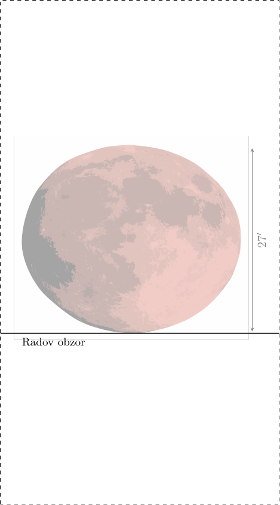
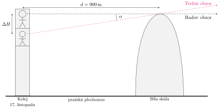
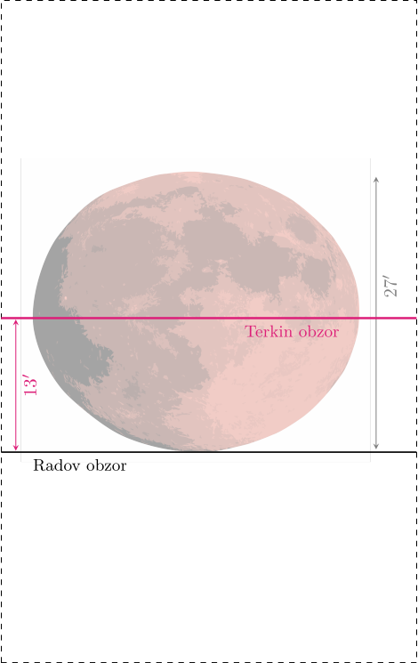
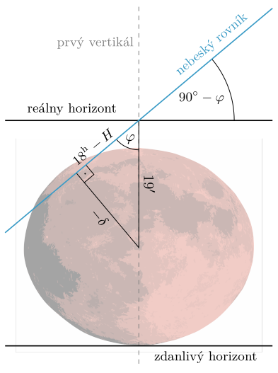
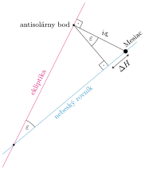

## Zadanie

<figure>

<figcaption>

**Obrázok 1:** Zdanlivá poloha obzoru vytvoreného kopcom *Bílá Skála* vzhľadom na polohu Mesiaca na oblohe.
</figcaption>

</figure>

Rado a Terka súčasne pozorujú spln Mesiaca z okien internátu, *Koleje 17. listopadu*. Ide o 22. najvyššiu budovu v Prahe, s výškou až $69\,\mathrm{m}$. Má 22 podlaží vrátane prízemia a tajného mýtického poschodia. Všetky podlažia sú rovnako vysoké a nad tým najvyšším je hneď strecha. Mesiac vychádza presne na svetovej strane východ nad neďaleký kopec *Bílá skála* v horizontálnej vzdialenosti $900\,\mathrm{m}$ od *Koleje 17. listopadu*.

Rado býva na najvyššom podlaží, jeho oči sa nachádzajú v rovnakej nadmorskej výške ako vrchol *Bílej skály* a vidia, ako sa spodný okraj Mesiaca práve dotýka tohto vrcholu. Mesiac je kvôli rozdielnej atmosférickej refrakcii (v rôznych výškach nad horizontom) sploštený o $5'$ vo vertikálnom smere, viď. obrázok 1. Hodnota atmosférickej refrakcie na horizonte je $35'$. Červenkastá farba Mesiaca je spôsobená Rayleighovým rozptylom v atmosfére, čo je efekt spôsobujúci silnejší rozptyl modrého svetla voči červenému.

Terka meria $158\,\mathrm{cm}$, pozoruje Mesiac rovnako sploštený a býva na izbe o jedno poschodie nižšie ako Rado, ktorý meria $188\,\mathrm{cm}$. Pre oboch platí, že sa ich oči nachádzajú v deviatich desatinách tela. Zemepisné súradnice Prahy sú $50^{\circ}\,\rm{N}~\rm{a}~14{,}5^{\circ}\,\rm{E}$.

**Úlohy**

<ol type="a">

<li>

[40 b] Do obrázku 1 zakreslite obzor, ktorý zdanlivo vidí Terka, s presnosťou na $1'$.

</li>

<li>

[20 b] Určte deklináciu Mesiaca, s presnosťou na $1^{\circ}$.

</li>

<li>

[10 b] Určte hodinový uhol Mesiaca, s presnosťou na $0{,}1^{\mathrm{h}}$.

</li>

<li>

[20 b] Určte miestny pravý slnečný čas, s presnosťou na 1 hodinu.

</li>

<li>

[40 b] Určte, ako dlho vychádzal Mesiac nad Radov obzor, s presnosťou na $0{,}1\,\mathrm{min}$.

</li>

</ol>

Riešenie

<ol type="a">

<li>

Geometria problému je zobrazená na obrázku 2.[10 b] Terka je na nižšom poschodí ako Rado, čo znamená, že jej obzor bude zdanlivo vyššie ako ten Radov, čiže Mesiac uvidí len sčasti alebo vôbec. Rozhodovať o tom bude uhol $\alpha$, ktorý vieme určiť z pravouhlého trojuholníka, ktorého vrcholy sú: vrchol kopca *Bílá skála*, Radove oči, Terkine oči; s pravým uhlom pri Radových očiach. Platí 

$$
\tan \alpha = \frac{\Delta H}{d} \,,
    \qquad\textit{[10\,b]} \tag{1}
$$

 pričom $\Delta H$ určíme z informácií zo zadania.

Vieme, že budova je vysoká $69\,\mathrm{m}$ a má 22 podlaží, čiže jedno podlažie má výšku $(69/22)\,\mathrm{m}$[5 b]. Radove oči sa nachádzajú vo výške $0,9\cdot188\,\mathrm{cm}$ a Terkine vo výške $0,9\cdot158\,\mathrm{cm}$. Rozdiel výšky ich očí prirátame k celkovému $\Delta H$,[5 b] a teda 

$$
\Delta H = \left(\frac{69}{22} + 0,9 \cdot (1,88 - 1,58) \right) \mathrm{m} = \frac{3747}{1100} \, \mathrm{m} \,. \tag{2}
$$

Po dosadení do (1) dopočítame uhol 

$$
\alpha = \arctan\left( \frac{3747}{1100} \,\mathrm{m} \cdot \frac{1}{900\,\mathrm{m}} \right) \doteq
    \boxed{13{,}0'} \,.
    \qquad\textit{[3\,b]} \tag{3}
$$

Mesiac na obzore má uhlový priemer $27'$, čiže Terka uvidí približne polovicu Mesiaca. Zákres polohy jej obzoru nájdete na obrázku 3. [7 b]

<figure>

<figcaption>

**Obrázok 2:** Schéma *Koleje 17. listopadu*, kopca *Bílá skála* a obzorov pre Rada a Terku.
</figcaption>

</figure>

</li>

</ol>

<ol type="a" start="2">

<li>

Začneme rýchlou odpoveďou. Deklinácia $\delta$ je kolmá vzdialenosť od nebeského rovníka.[5 b] Ten pretína horizont na východe,[5 b] kde sa akurát nachádza aj Mesiac. To znamená, že Mesiac leží na nebeskom rovníku, čiže jeho deklinácia je $0^{\circ}$.[5 b] Chyba určenia deklinácie spočíva v zanedbaní refrakcie a rozmerov Mesiaca. Oba tieto efekty sú však v ráde desiatok uhlových minút, takže určená deklinácia spĺňa požadovanú presnosť $1^{\circ}$.[5 b]

Teraz podrobnejšie. V zadaní je uvedené, že sa spodný okraj Mesiaca dotýka Radovho obzoru. Ten je totožný s horizontom, nakoľko sú Radove oči a vrch kopca Bílá skála v rovnakej výške. Refrakcia $35'$ znamená, že spodný okraj Mesiaca, ktorý vidíme na horizonte, sa reálne nachádza $35'$ pod horizontom. Horný okraj Mesiaca vidíme vo výške $27'$, pričom refrakcia v tomto mieste je o $5'$ menšia ako na horizonte, teda jej hodnota je $30'$. Horný okraj Mesiaca sa preto reálne nachádza $3'$ pod horizontom. Rozumný odhad polohy stredu Mesiaca je priemer polôh horného a dolného okraja, čiže $19'$ pod horizontom.

Nebeský rovník pretína reálny horizont presne na východe, čo je vo vzdialenosti $19'$ od stredu Mesiaca. Deklinácia Mesiaca bude záporná (stred Mesiaca je pod reálnym horizontom), pričom v absolútnej hodnote bude jej hodnota menšia ako $19'$, nakoľko je nebeský rovník sklonený voči horizontu pod uhlom $90^{\circ} - \varphi$, kde $\varphi = 50^{\circ}$ je zemepisná šírka pozorovacieho miesta. Deklináciu vypočítame sínusovou vetou z trojuholníka na obrázku 3; 

$$
\frac{\sin (-\delta)}{\sin \varphi} = \frac{\sin 19'}{\sin{90^{\circ}}} \enspace \Rightarrow \enspace
    \boxed{\delta \doteq -14{,}6'} \,. \tag{4}
$$

 Alternatívne je možné trojuholník aproximovať rovinnou geometriou, keďže ide o malé uhly. Potom $\sin{\varphi} = \linfrac{-\delta}{19'}$, z čoho rovnako dostaneme $\delta \doteq -14{,}6'$.

</li>

</ol>

<figure>

<figcaption>

**Obrázok 3b:** Presná geometria.
</figcaption>

</figure>

<ol type="a" start="3">

<li>

Hodinový uhol $H$ meriame pozdĺž nebeského rovníka od juhu smerom na západ.[5 b] Mesiac sa nachádza na východe, čo je v troch štvrtinách nebeského rovníka. Celý kruh má $360^{\circ}$, respektíve $24^{\mathrm{h}}$, čo je jednotka, v ktorej bežne uvádzame hodinový uhol. Preto 

$$
H = \frac{3}{4} \cdot 24^{\mathrm{h}} = \boxed{18^{\mathrm{h}}} \,.
    \qquad\textit{[5\,b]} \tag{5}
$$

 Požadovaná presnosť $0{,}1^{\mathrm{h}}$ odpovedá presnosti $1{,}5^{\circ}$, čo je ešte väčší uhol ako presnosť pre deklináciu. Bude nám teda postačovať takáto jednoduchá úvaha.

Ak by sme chceli spočítať hodinový uhol $H$ presnejšie, opäť použijeme trojuholník z obrázka 3. Hodinový uhol je určený kolmým priemetom stredu Mesiaca na nebeský rovník. Ak by tento priemet ležal presne na východe, tak by bol hodinový uhol presne rovný $18^{\mathrm{h}}$. Avšak ako vidíme z obrázka, priemet je posunutý o trochu pod horizont, teda hodinový uhol je menší ako $18^{\mathrm{h}}$. Prejdeme rovno do aproximácie rovinnou geometriou, v ktorej platí 

$$
\cos \varphi = \frac{18^{\mathrm{h}} - H}{19'} \ztv
    \boxed{H \doteq 17{,}986^{\mathrm{h}}} \,. \tag{6}
$$

</li>

<li>

Pre toto podzadanie je kľúčovou informáciou to, že je Mesiac v splne, keďže nám to napovedá o polohe Slnka. To sa počas splnu nachádza oproti Mesiacu na druhej strane oblohy[10 b]. Mesiac je aktuálne na horizonte na východe, čo implikuje, že sa Slnko nachádza na horizonte na západe, kadiaľ takisto prechádza nebeský rovník. Slnko teda leží na nebeskom rovníku a práve zapadá, z čoho vyplýva, že jeho hodinový uhol je $6^{\mathrm{h}}$.[5 b] Hodinový uhol určuje čas, ktorý ubehol od hornej kulminácie Slnka. Pravý slnečný čas sa však riadi dolnou kulmináciou Slnka – je nulový o polnoci, keď je Slnko najnižšie pod horizontom. Medzi dolnou a hornou kulmináciou ubehne $12^{\mathrm{h}}$, a teda pravý slnečný čas v čase pozorovania je 

$$
\boxed{t_\Sun = 18^{\mathrm{h}}} \,.
    \qquad\textit{[5\,b]} \tag{7}
$$

</li>

</ol>

<figure>

<figcaption>

**Obrázok 4:**
</figcaption>

</figure>

Nepresnosť výsledku opäť spočíva aj v refrakcii a uhlovom rozmere Mesiaca, avšak tentoraz je dominantný vplyv toho, že sa Mesiac nemusí nachádzať priamo na ekliptike, ale až do vzdialenosti maximálne $i_\Mo = 5^{\circ}\,8'$ kolmo od nej. Slnko sa ale z definície musí nachádzať na ekliptike, čo znamená, že na oblohe nie je presne oproti Mesiacu. Bod, ktorý je presne oproti Slnku, nazývame antisolárny bod, pričom ak je Mesiac v splne, tak je tento bod tam, kde je aj kolmý priemet stredu Mesiaca na ekliptiku, viď. obrázok 4. Pre jednoduchosť zanedbávame refrakciu, fyzické rozmery Mesiaca a efekty sférickej geometrie. Pre približný odhad rozdielu hodinového uhla $\Delta H$ Mesiaca a antisolárneho bodu nám to úplne postačí.

Nakoľko uvažujeme rovinnú geometriu, vieme preniesť uhol $\varepsilon = 23^{\circ}\,26'$ sklonu nebeského rovníka a ekliptiky do trojuholníka tvoreného Mesiacom, antisolárnym bodom a priemetom antisolárneho bodu na nebeský rovník. Dostávame 

$$
\sin \varepsilon = \frac{\Delta H}{i_\Mo} \ztv
    \Delta H = 5^{\circ}\,8' \cdot \sin(23^{\circ}\,26') \doteq 2{,}0^{\circ} = 8^{\mathrm{min}} \,. \tag{8}
$$

 O rovnaké $\Delta H$ bude maximálne posunuté aj skutočné Slnko voči strednej hodnote hodinového uhla $6^{\mathrm{h}}$, a to oboma smermi, do väčších aj menších hodnôt. Pravý slnečný čas je hodinový uhol plus $12^{\mathrm{h}}$, takže aj ten môže byť o $8^{\mathrm{min}}$ menší či väčší. Každopádne do požadovanej presnosti $1^{\mathrm{h}}$ sa určite vojdeme.

<ol type="a" start="5">

<li>

Pre určenie času východu Mesiaca potrebujeme vypočítať uhlovú vzdialenosť, ktorú potrebuje prejsť jeho stred, a uhlovú rýchlosť, ktorou sa po oblohe pohybuje. Doba východu Mesiaca je čas medzi okamihom, kedy sa zdanlivého horizontu (Radovho obzoru) dotkne horný okraj Mesiaca (1. kontakt), a okamihom, kedy sa horizontu dotkne dolný okraj Mesiaca[5 b] (2. kontakt).

Počas 1. kontaktu je horný okraj Mesiaca zdanlivo v nulovej výške nad horizontom, avšak reálne je kvôli refrakcii vo výške $-35'$. Počas 2. kontaktu je horný okraj Mesiaca v zdanlivej výške $27'$, pričom refrakcia je pre túto výšku o $5'$ menšia ako na horizonte, čiže reálne je horný okraj Mesiaca vo výške $27' - (35' - 5') = -3'$. Rovnakú úvahu sme vykonali v nadstavbe pre podzadanie (b). Horný okraj Mesiaca potrebuje teda v smere kolmo na horizont prejsť uhlovú vzdialenosť 

$$
\Delta h = -3' - (-35') = 32' \,,
    \qquad\textit{[7\,b]} \tag{9}
$$

 čiže reálny uhlový priemer Mesiaca.

Rovnakú vertikálnu uhlovú vzdialenosť musí prejsť aj stred Mesiaca. Pohyb Mesiaca je však šikmo na horizont – vychádza takmer presne pod uhlom sklonu nebeského rovníka, teda pod uhlom $90^{\circ} - \varphi = 40^{\circ}$.[5 b] Dôvodom, prečo to nie je úplne presne $40^{\circ}$, je skutočnosť, že deklinácia Mesiaca nie je presne nula, a teda nevychádza priamo pozdĺž nebeského rovníka, ale po vedľajšej kružnici trošku vedľa. Takisto, deklinácia Mesiaca nie je počas jeho vychádzania konštantná, rovnako ako jeho ekliptikálna šírka, ktorá sa počas obehu Mesiaca okolo Zeme mení v intervale od $-i_\Mo$ do $+i_\Mo$. Oba tieto efekty však môžeme zanedbať a uvažovať, že Mesiac vychádza pod uhlom $90^{\circ} - \varphi$ voči horizontu.

Takisto budeme uvažovať rovinnú geometriu, čiže uhlová vzdialenosť $x$, ktorú musí prejsť, je 

$$
x = \frac{\Delta h}{\sin(90^{\circ} - \varphi)} = \frac{32'}{\sin(90^{\circ} - 50^{\circ})} = 49{,}783' \,.
    \qquad\textit{[5\,b]} \tag{10}
$$

 Uhlová rýchlosť $\omega$ pohybu Mesiaca po oblohe je daná dvoma efektmi:

- rotácia Zeme ($360^{\circ}$ za $t_\Ea = 23\,\mathrm{h}\;56\,\mathrm{min}\;4{,}1\,\mathrm{s}$) s uhlovou rýchlosťou 

$$
\omega_R = \frac{360^{\circ}}{23\,\mathrm{h}\;56\,\mathrm{min}\;4{,}1\,\mathrm{s}} = 
        15{,}041\,^\circ/\mathrm{h} = 15{,}041\,'/\mathrm{min} \,, \qquad\textit{[8\,b]} \tag{11}
$$

- obeh Mesiaca okolo Zeme ($360^{\circ}$ v priemere za $P_\Mo = 27{,}32\,\mathrm{dňa}$) s uhlovou rýchlosťou 

$$
\omega_O = \frac{360^{\circ}}{27{,}32\,\mathrm{dňa}} =
        \frac{360^{\circ}}{27,32 \cdot 24\,\mathrm{h}} =
        0{,}549\,^\circ/\mathrm{h} =
        0{,}549\,'/\mathrm{min} \,.
        \qquad\textit{[4\,b]} \tag{12}
$$

Rotácia Zeme otáča oblohu pravotočivo, keďže hviezdy od juhu putujú na západ. Naproti tomu sa Mesiac hýbe medzi hviezdami ľavotočivo, podobne ako Slnko sa mu postupne zväčšuje ekliptikálna dĺžka. To znamená, že $\omega_R$ a $\omega_O$ pôsobia proti sebe, a teda sa odčítavajú. Celková uhlová rýchlosť Mesiaca je preto 

$$
\omega = \omega_R - \omega_O =
     15{,}041\,'/\mathrm{min} - 0{,}549\,'/\mathrm{min} =
     14{,}492\,'/\mathrm{min} \,.
     \qquad\textit{[4\,b]} \tag{13}
$$

 Čas východu Mesiaca je 

$$
t = \frac{x}{\omega} =
     \frac{49{,}783'}{14{,}492\,'/\mathrm{min}} \doteq
     3{,}44\,\mathrm{min} = \boxed{3\,\mathrm{min}\;26\,\mathrm{s}} \,.
     \qquad\textit{[2\,b]} \tag{14}
$$

 Odhadnime ešte, akej nepresnosti sme sa dopustili zanedbaním excentricity dráhy Mesiaca $e_\Mo = 0{,}0549$. Rýchlosť pohybu Mesiaca po oblohe totiž nie je konštantná, ako sme uvažovali, ale je naopak premenlivá. Pomer rýchlosti v perigeu a apogeu je 

$$
\frac{v_P}{v_A} = \frac{1+e_\Mo}{1-e_\Mo} \,. \tag{15}
$$

 Uhlová rýchlosť Mesiaca $\omega_O$ spôsobená obehom Mesiaca okolo Zeme závisí aj od vzdialenosti Mesiaca od Zeme. Ak označíme vzdialenosť v perigeu ako $q$, vzdialenosť v apogeu ako $Q$ a veľkú polos dráhy ako $a$, tak pre pomer uhlových rýchlostí v perigeu a apogeu máme 

$$
\frac{\omega_{O,P}}{\omega_{O,A}} = \frac{\frac{v_P}{q}}{\frac{v_A}{Q}} = \frac{v_P}{v_A} \cdot \frac{Q}{q} =
    \frac{1+e_\Mo}{1-e_\Mo}\cdot \frac{a(1+e_\Mo)}{a(1-e_\Mo)} = \left(\frac{1+e_\Mo}{1-e_\Mo}\right)^2 \doteq
    1{,}25 \,. \tag{16}
$$

 Rozdiely uhlovej rýchlosti $\omega_O$ obehu Mesiaca okolo Zeme sú teda až $25\,\%$. Stredná hodnota je $0{,}549\,'/\mathrm{min}$, čiže nepresnosť uhlovej rýchlosti je približne $0{,}07\,'/\mathrm{min}$, čo je $0,45\,\%$ celkovej uhlovej rýchlosti $\omega$. Nepresnosť vypočítaného času je preto $0,45\,\% \cdot 3{,}44\,\mathrm{min} \doteq 1\,\mathrm{s}$, čo je v rámci požadovanej presnosti $0{,}1\,\mathrm{min} = 6\,\mathrm{s}$.

Drobnej nepresnosti sme sa dopustili aj pri výpočte uhlovej rýchlosti, ktorá je spôsobená rotáciou Zeme. Keďže sa Mesiac nenachádza presne na nebeskom rovníku, jeho uhlová rýchlosť bude škálovaná kosínusom deklinácie $\cos \delta = \cos(14{,}6') = 0,999991$, čo však urobí vskutku zanedbateľný rozdiel. Navyše sa rovnakým faktorom škáluje dráha, ktorú Mesiac potrebuje prejsť na to, aby vyšiel, čo vykompenzuje efekt zmenšenia uhlovej rýchlosti.

</li>

</ol>

