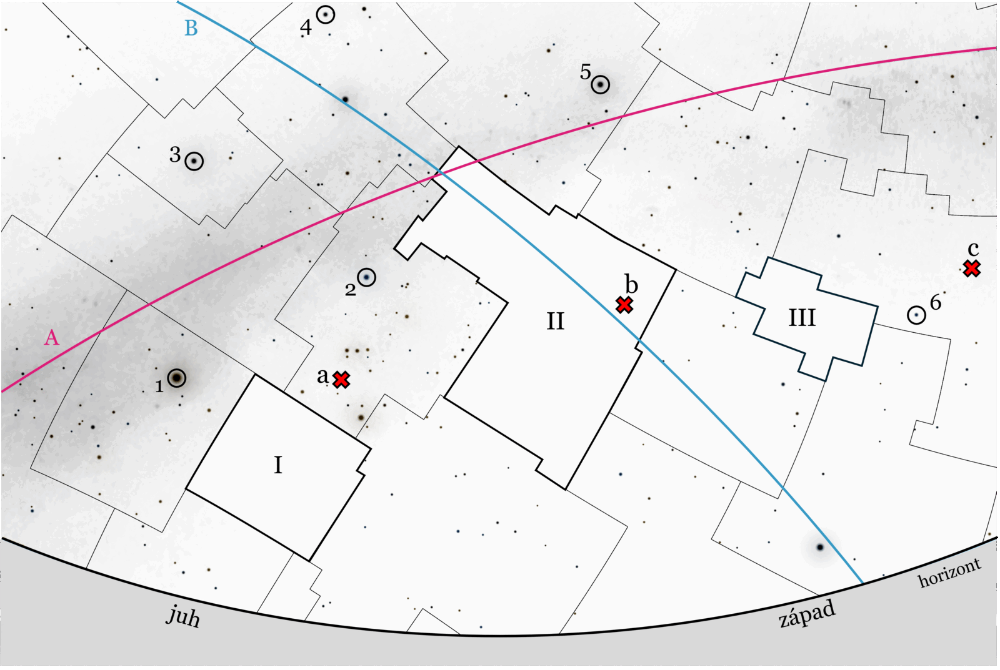

## Zadanie

Priložená mapa zobrazuje pohľad na nočnú oblohu pre Liptovský Mikuláš z dnešného dňa o 19:00. Pozeráte sa smerom na juhozápad, čiže súhvezdia na mape budú čoskoro zapadať, pričom niektoré z nich sú zakryté. Zároveň sú na mape aktuálne viditeľné aj dve jasné planéty.

<ol type="a">

<li>

[36 b] Pre čísla 1 až 6 napíšte názov hviezdy, slovenský názov súhvezdia, v ktorom sa nachádza, a latinskú skratku tohto súhvezdia.

</li>

<li>

[15 b] Rímskymi číslami I, II, III sú označené zakryté súhvezdia. Pomocou okolitých súhvezdí určte, o ktoré súhvezdia ide. Napíšte ich slovenské názvy a latinské skratky.

</li>

<li>

[15 b] Malými písmenami „a“, „b“, „c“ sú označené tri objekty z Messierovho katalógu. Ku každému písmenu napíšte názov objektu a jeho číslo v Messierovom katalógu.

</li>

<li>

[4 b] Na mape sú farebne vyznačené dve dôležité kružnice na nebeskej sfére, označené veľkými písmenami „A“, „B“. Určte, o aké kružnice ide.

</li>

<li>

[10 b] Na zobrazenej časti oblohy sa okrem hviezd nachádzajú aj dve planéty slnečnej sústavy. Nájdite, zakrúžkujte a pomenujte ich na mape.\
*Poznámka: Ani jedna z planét sa nenachádza v žiadnom zo zakrytých súhvezdí.*

</li>

</ol>

<figure>

<figcaption>

**Obrázok 1:** Slepá mapa. Rímske čísla označujú súhvezdia, arabské číslice označujú hviezdy, malé písmená označujú Messierove objekty a veľké písmená označujú významné kružnice na nebeskej sfére. Zdroj podkladovej mapy: Stellarium.
</figcaption>

</figure>

Riešenie

<ol type="a">

<li>

Na mape oblohy sú zakrúžkované nasledujúce hviezdy (v zátvorke je uvedené súhvezdie, v ktorom sa nachádzajú, spolu so skratkou tohto súhvezdia):

1: Sírius (Veľký pes, CMa), [2 b]\
2: Betelgeuze (Orión, Ori), [2 b]\
3: Prokyón (Malý pes, CMi), [2 b]\
4: Pollux (Blíženci, Gem), [2 b]\
5: Capella (Povozník, Aur), [2 b]\
6: Mirach (Androméda, And)[2 b].

</li>

<li>

Aby sme identifikovali zakryté súhvezdia na mape, musíme sa spoľahnúť na znalosť okolitých súhvezdí. Z toho zistíme, že to sú: I: Zajac (Lep), II: Býk (Tau), III: Trojuholník (Tri). [5 b]

</li>

<li>

Objekty „a“ a „c“ určíme pomocou ich polohy v rámci viditeľných súhvezdí. Vidíme, že objekt „a“ je Veľká hmlovina v Orióne (M42)[5 b] a objekt „c“ je Galaxia v Androméde (M31). Zvyšný objekt s označením „b“ je mierne náročnejší, keďže sa nachádza v zakrytom súhvezdí Býka a na jeho určenie potrebujeme aj znalosť jeho polohy vzhľadom na hranice súhvezdia. Ide o známu hviezdokopu Plejády (M45). [5 b]

</li>

<li>

Kružnica „A“ je galaktický rovník,[2 b] čiže myslená čiara, ktorá prechádza stredom disku našej galaxie Mliečnej dráhy na hviezdnej oblohe. Z mapy sme ju vedeli určiť buď vďaka znalostiam o súhvezdiach, ktorými prechádza, alebo sme si mohli všimnúť rameno Mliečnej dráhy, ktoré na mape vieme rozoznať ako tmavší pás na oblohe oproti jej zvyšku. Kružnica „B“ je ekliptika,[2 b] čiže zdanlivá ročná dráha Slnka po hviezdnej oblohe. Určiť sme ju mohli napríklad pomocou znalosti zvieratníkových súhvezdí (súhvezdí, v ktorých sa určitú časť roka nachádza Slnko).

</li>

<li>

Vieme, že planéty obiehajú okolo Slnka približne v rovnakej rovine ako Zem, čiže sa musia nachádzať v blízkosti ekliptiky. Na mape ich identifikujeme ako jasné objekty na miestach, kde sa žiadna jasná hviezda nenachádza. Takéto objekty sú na mape dva, jeden je planéta Jupiter v súhvezdí Blíženci, druhý je planéta Venuša v súhvezdí Ryby.[5 b] Schopnosť určiť, o ktoré planéty ide, vychádza z praktickej znalosti aktuálnej oblohy v dobe konania súťaže.

Niektoré planéty išlo takisto okamžite vylúčiť na základe jasnosti alebo uhlovej vzdialenosti od Slnka. Napríklad planéta v Blížencoch určite nemôže byť Merkúr ani Venuša, pretože sa nachádza vysoko nad obzorom, zatiaľ čo Slnko už zapadlo. Takisto nemôže ísť o slabé planéty ako Urán a Neptún. Realistickými možnosťami zostávajú teda iba Mars, Jupiter a Saturn. Naopak, planéta v Rybách je blízko horizontu večer na západe, čo silne indikuje Merkúr alebo Venušu. Navyše jej vysoká jasnosť nás presvedčí o tom, aby sme z týchto dvoch možností zvolili tú druhú.

</li>

</ol>

## Komentár autora

Rýchla poznávačka, ktorá testuje znalosti nočnej oblohy všeobecne, ale aj v deň konania súťaže (polohy planét), a to konkrétne 23. 3. 2026.
