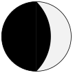

## Zadanie

Tento rok nás čaká úplné zatmenie Slnka pozorovateľné z Európy. Predpokladajme, že ste sa v auguste 2026 rozhodli vycestovať za týmto úchvatným nebeským úkazom. Konkrétne do mesta Zaragoza v Španielsku, kde budú dobré podmienky na pozorovanie – nízka pravdepodobnosť oblačnosti a skoro minútu a pol dlhá úplná fáza zatmenia, počas ktorej bude Mesiac plne zakrývať Slnko.

Pri príprave na pozorovanie zatmenia ste si zistili nasledujúce informácie:

- Stred úplnej fázy nastane 12. 8. 2026 o 20:29 letného stredoeurópskeho času (LSEČ).

- Zatmenie nastane tesne pred západom Slnka (približne pol hodinu).

- Slnko sa počas zatmenia nachádza na okraji súhvezdia Lev, blízko súhvezdia Rak.

Pri riešení úlohy predpokladajte, že dráhy Zeme a Mesiaca sú kružnice ležiace v spoločnej rovine. Inými slovami to znamená, že sa Slnko a Mesiac pohybujú po oblohe rovnomerne.

**Úlohy**

<ol type="a">

<li>

[5 b] Aká bude fáza Mesiaca počas zatmenia?\
i. nov ii. prvá štvrť iii. spln iv. posledná štvrť

</li>

<li>

[5 b] Ktorý významný meteorický roj bude mať maximum deň po zatmení?

</li>

<li>

[25 b] V ktorý deň po zatmení budete môcť zo Zaragozy najbližšie pozorovať Mesiac vo fáze prvej štvrte?

</li>

<li>

[5 b] Prepočítajte čas stredu úplnej fázy zatmenia do UTC (teda do času, ktorý sa riadi nultým poludníkom prechádzajúcim cez Londýn).

</li>

</ol>

O pár mesiacov neskôr, 14. decembra 2026, nastane maximum ďalšieho významného meteorického roja – roja s názvom Geminidy. Ako správni astronómovia si nemôžete nechať ujsť ani túto nebeskú šou. Na pozorovanie ste si pripravili teplé oblečenie, karimatku aj spacák, ale obávate sa, či by pozorovanie nemohol pokaziť Mesiac.

<ol type="a" start="5">

<li>

[5 b] V akom súhvezdí sa nachádza radiant roja Geminidy?

</li>

<li>

[10 b] Koľko dní ubehne medzi zatmením a maximom roja Geminidy?

</li>

<li>

[25 b] Načrtnite fázu Mesiaca počas maxima roja Geminidy pri pozorovaní zo Zaragozy.

</li>

<li>

[30 b] Odhadnite, v akom súhvezdí sa bude Mesiac nachádzať počas tohto maxima.

</li>

<li>

[10 b] Bude Mesiac znepríjemňovať pozorovanie maxima roja Geminidy alebo nie? Svoju odpoveď riadne odôvodnite.

</li>

</ol>

Riešenie

<ol type="a">

<li>

Počas zatmenia sa Mesiac nachádza medzi Zemou a Slnkom, čo znamená, že osvietená pologuľa Mesiaca je od Zeme odvrátená. Tým pádom je Mesiac vo fáze nov. [5 b]

</li>

<li>

Okolo 12. augusta je každoročne maximum asi najznámejšieho meteorického roja, a to roja Perzeidy. V roku 2026 maximum vychádza na 16:53 LSEČ. [5 b]

</li>

<li>

Synodická obežná perióda Mesiaca je podľa konštantovníka $S_\Mo = 29{,}53\,\mathrm{dňa}$. [5 b] Ide o dobu od splnu po nasledujúci spln, respektíve od novu po nasledujúci nov. Od novu po prvú štvrť ubehne štvrtina synodickej doby, konkrétne 

$$
\frac{S_\Mo}{4} = \frac{29{,}53\,\mathrm{dňa}}{4} \doteq 7{,}5\,\mathrm{dňa} \,. \qquad\textit{[10\,b]} \tag{1}
$$

 Zatmenie nastalo 12. 8. večer. O 7 dní neskôr bude 19. 8. [5 b] večer a pridanie posledného poldňa nám dá ráno nasledujúceho dňa. Prvú štvrť budeme teda pozorovať 20. 8. ráno, presnejšie okolo 5:40. [5 b]

</li>

<li>

Keďže sme voči nultému poludníku pásmovo posunutí o jednu hodinu a letný čas spôsobuje posun o jednu ďalšiu hodinu, tak platí 

$$
\text{LSEČ} = \text{UTC} + 2\,\mathrm{h} \,, \tag{2}
$$

 čiže $\text{UTC} = \text{LSEČ} - 2\,\mathrm{h}$, takže stačí od 20:29 odčítať 2 hodiny. Dostávame čas 18:29 UTC. [5 b]

</li>

<li>

Názov meteorického roja je odvodený od súhvezdia, v ktorom sa nachádza jeho radiant (miesto na oblohe, z ktorého zdanlivo vylietavajú meteory daného roja). Pre Perzeidy je radiant v súhvezdí Perzeus. Pre Geminidy je radiant v súhvezdí, ktoré má latinský názov Gemini, teda v súhvezdí Blíženci. [5 b]

</li>

<li>

Máme spočítať počet dní medzi 12. 8. a 14. 12. Vidíme, že to sú 4 mesiace a 2 dni. Ak by každý mesiac mal 30 dní, dostaneme $4 \cdot 30\,\mathrm{dní} + 2\,\mathrm{dní} = 122\,\mathrm{dní}$. [5 b] Avšak august a október majú 31 dní, čím získame 2 dni navyše. Dokopy máme $\boxed{124\,\mathrm{dní}}$. [5 b]

</li>

<li>

Počas zatmenia 12. augusta bol Mesiac v nove. Do novu sa následne opakovane dostal vždy o $29{,}53\,\mathrm{dňa}$ neskôr, čo si vieme rozpísať do prehľadovej tabuľky 1. [10 b] Na základe nej vidíme, že požadovaných $124\,\mathrm{dní}$ do 14. 12. ubehlo niekde medzi štvrtým a piatym novom, konkrétne asi $6\,\mathrm{dní}$ po tom štvrtom (keďže $124\,\mathrm{dní} - 118{,}12\,\mathrm{dňa} = 5{,}88\,\mathrm{dňa} \doteq 6\,\mathrm{dní}$). [5 b]

V podzadaní (a) sme zistili, že Mesiac sa v prvej štvrti nachádza približne $7{,}5\,\mathrm{dní}$ od novu. V deň maxima Geminíd bude $6\,\mathrm{dní}$ po nove, čiže vo fáze dorastajúceho kosáčika, ktorý je načrtnutý na obrázku 1. [10 b]

**Tabuľka 1:** Prehľadová tabuľka Mesiaca vo fáze novu.

| Poradové číslo novu | Počet dní od zatmenia |
|:-------------------:|:----------------------|
|          0          | $0 \cdot 29{,}53\,\mathrm{dňa} = 0\,\mathrm{dní}$             |
|          1          | $1 \cdot 29{,}53\,\mathrm{dňa} = 29{,}53\,\mathrm{dňa}$             |
|          2          | $2 \cdot 29{,}53\,\mathrm{dňa} = 59{,}06\,\mathrm{dňa}$             |
|          3          | $3 \cdot 29{,}53\,\mathrm{dňa} = 88{,}59\,\mathrm{dňa}$             |
|          4          | $4 \cdot 29{,}53\,\mathrm{dňa} = 118{,}12\,\mathrm{dňa}$             |
|          5          | $5 \cdot 29{,}53\,\mathrm{dňa} = 147{,}65\,\mathrm{dňa}$             |

<figure>

<figcaption>

**Obrázok 1:** Náčrt fázy Mesiaca.
</figcaption>

</figure>

</li>

<li>

Počas zatmenia vieme, že bol Mesiac v súhvezdí Lev, blízko súhvezdia Rak. Na toto miesto medzi hviezdami sa opakovane dostal vždy o $27{,}32\,\mathrm{dňa}$ neskôr, [10 b] čo je siderická obežná doba Mesiaca, ktorú vieme nájsť v konštantovníku. Opäť si vieme spraviť prehľadovú tabuľku, viď. tabuľka 2. Vidíme, že $124\,\mathrm{dní}$ ubehne medzi štvrtým a piatym obehom, konkrétne asi $15\,\mathrm{dní}$ po tom štvrtom (keďže $124\,\mathrm{dní} - 109{,}28\,\mathrm{dňa} = 14{,}72\,\mathrm{dňa} \doteq 15\,\mathrm{dní}$). [5 b]

**Tabuľka 2:** Prehľadová tabuľka siderických obehov Mesiaca.

| Poradové číslo obehu | Počet dní od zatmenia |
|:--------------------:|:----------------------|
|          0           | $0 \cdot 27{,}32\,\mathrm{dňa} = 0\,\mathrm{dní}$             |
|          1           | $1 \cdot 27{,}32\,\mathrm{dňa} = 27{,}32\,\mathrm{dňa}$             |
|          2           | $2 \cdot 27{,}32\,\mathrm{dňa} = 54{,}64\,\mathrm{dňa}$             |
|          3           | $3 \cdot 27{,}32\,\mathrm{dňa} = 81{,}96\,\mathrm{dňa}$             |
|          4           | $4 \cdot 27{,}32\,\mathrm{dňa} = 109{,}28\,\mathrm{dňa}$             |
|          5           | $5 \cdot 27{,}32\,\mathrm{dňa} = 136{,}60\,\mathrm{dňa}$             |

Mesiac sa pri svojom pohybe po oblohe pohybuje v blízkosti ekliptiky, teda prechádza cez rovnaké súhvezdia ako Slnko. Konkrétne: Rak, Lev, Panna, Váhy, Škorpión, Hadonos, Strelec, Kozorožec, Vodnár, Ryby, Baran, Býk a Blíženci, pričom sme týchto 13 súhvezdí zoradili podľa ich výskytu na oblohe. Mesiac prejde všetky za $27{,}32\,\mathrm{dňa}$, čiže za 15 dní prejde niečo vyše polovicu z nich. Dostane sa teda do polovice zoznamu, čo je Kozorožec alebo Vodnár. Obe tieto možnosti boli považované za správne. (V skutočnosti bude v súhvezdí Kozorožec.) [15 b]

</li>

<li>

Keďže sa Mesiac nachádza 4 až 5 súhvezdí od radiantu a je pomerne ďaleko od splnu, tak pozorovanie meteorického roja nebude výrazne ovplyvňovať. Vo večerných hodinách sa bude nachádzať nad obzorom, ale pomerne skoro zapadne. [10 b]

</li>

</ol>

