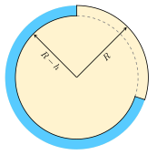

## Zadanie

V mnohých hvezdárňach sa na propagáciu a edukáciu využívajú nafukovacie modely planét. Na hvezdárni, kde pracuje Sam, predstavili ako novinku model *Litosféra*, teda model Zeme bez vody, ktorý má priemer 10 metrov. Vedľa modelu Zeme je vyrobená menšia kovová guľa, ktorá predstavuje všetku vodu na Zemi. Vypočítajte priemer tejto gule.

O vode na Zemi vieme, že pokrýva $70\,\%$ jej povrchu. Pre jednoduchosť predpokladajte, že všetka voda je obsiahnutá v oceánoch (túto aproximáciu môžeme urobiť vďaka tomu, že až $97\,\%$ objemu vody sa nachádza v oceánoch) a že všetky oceány majú hĺbku $3800\,\mathrm{m}$.

Riešenie

Ako prvé si musíme hĺbku oceánov previesť do mierky modelu. Priemer modelu $10\,\mathrm{m}$ reprezentuje priemer Zeme v skutočnosti, ktorý je dvojnásobkom polomeru Zeme $R_\Ea$, teda číselne $2 R_\Earth = 2 \cdot 6378\,\mathrm{km} = 12\,756\,\mathrm{km} = 1{,}2756 \cdot 10^{7}\,\mathrm{m}$. [3 b]

Hĺbku oceánov na modelovej Zemi môžeme spočítať pomocou trojčlenky, kde na ľavej strane je priemer Zeme, na pravej hĺbka oceánov; a čitatele odpovedajú skutočnej Zemi a menovatele modelu: 

$$
\frac{1{,}2756 \cdot 10^{7}\,\mathrm{m}}{10\,\mathrm{m}} = \frac{3800\,\mathrm{m}}{h} \qquad\textit{[7\,b]}\,, \tag{1}
$$

 odkiaľ po prevrátení zlomkov dostaneme 

$$
\frac{10\,\mathrm{m}}{1{,}2756 \cdot 10^{7}\,\mathrm{m}} = \frac{h}{3800\,\mathrm{m}} \,, \tag{2}
$$

 a po vynásobení menovateľom z pravej strany dostaneme hĺbku oceánov v modelovej Zemi 

$$
h = \frac{10\,\mathrm{m}}{1{,}2756 \cdot 10^{7}\,\mathrm{m}} \cdot {3800\,\mathrm{m}} = 2{,}9790 \cdot 10^{-3}\,\mathrm{m} =2{,}9790\,\mathrm{mm}\qquad\textit{[5\,b]}\,. \tag{3}
$$

<figure>

<figcaption>

**Obrázok 1:** Schéma modelu Zeme. Obrázok predstavuje rez zemeguľou vedený cez jej stred. Modrá predstavuje nahromadené oceány, $R$ je polomer Zeme a $h$ je hĺbka oceánov.
</figcaption>

</figure>

Následne potrebujeme zistiť objem vody v mierke modelovej Zeme, ktorej polomer $R$ je polovica priemeru modelu, teda $R = (10 / 2)\,\mathrm{m} = 5\,\mathrm{m}$. Podľa zadania predpokladáme, že voda tvorí súvislú vrstvu do hĺbky $h$ a časť povrchu Zeme, ktorú pokrýva, je $k = 70\,\% = 0,70$. Objem vody je rovný $k$-násobku objemu tenkého sférického plášťa Zeme s hrúbkou $h$. Situácia je zobrazená na obrázku 1 vľavo.[20 b]

Jeden zo spôsobov, ako zistiť objem sférického plášťa, je vypočítať objem vonkajšej gule s polomerom $R$ a odčítať objem vnútornej gule s polomerom $R - h$.[5 b] Objem vonkajšej gule je daný vzťahom $V_E = \frac{4}{3} \pi R^3$ a vnútornej $V_I = \frac{4}{3} \pi (R - h)^3$[3 b].

Dosadením hodnôt dostaneme tieto objemy ako $V_E = 523{,}5988\,{\mathrm{m}}^{3}$ a $V_I = 522{,}6635\,{\mathrm{m}}^{3}$[2 b]. Potom tieto objemy odrátame a vynásobíme koeficientom $k$ (podiel oceánov), čím dostaneme objem vody 

$$
V = k \cdot (V_E - V_I) = 0,7 \cdot 0{,}935\,{\mathrm{m}}^{3} = 0{,}6547\,{\mathrm{m}}^{3} \qquad\textit{[5\,b]}\,. \tag{4}
$$

Z tohto objemu napokon vypočítame polomer menšej gule znázorňujúcej objem vody. Zo vzťahu pre objem 

$$
V = \frac{4}{3} \pi r^3 \qquad\textit{[5\,b]} \tag{5}
$$

 vyjadríme polomer 

$$
r = \sqrt[3]{\frac{3 V}{4 \pi}} = 0{,}5387\,\mathrm{m} \qquad\textit{[6\,b]}\,. \tag{6}
$$

Priemer gule zobrazujúcej vodu pre model Zeme (s priemerom $10\,\mathrm{m}$) je 

$$
d = 2 r = 2 \cdot 0{,}5387\,\mathrm{m} = 1{,}0756\,\mathrm{m} \doteq \boxed{1{,}1\,\mathrm{m}} \qquad\textit{[4\,b]}\,, \tag{7}
$$

 čo nám dáva veľmi dobrý obraz o množstve vody na Zemi. Objem gule s priemerom približne 1 meter je relatívne malý vzhľadom na objem gule s priemerom 10 metrov. Znamená to, že aj napriek tomu, že veľkú časť povrchu Zeme tvorí voda, tak voči objemu Zeme je objem vody relatívne zanedbateľný.

Iný spôsob, ako vypočítať objem vody v tenkom sférickom plášti, je predstaviť si, že ho rozvinieme do tenkého útvaru s výškou $h$ a plochou podstavy rovnou ploche oceánov.[8 b] Toto zjednodušenie si môžeme dovoliť na základe malej hrúbky plášťa v porovnaní s rozmerom gule. Plocha oceánov je rovná povrchu gule $S = 4 \pi R^2$[6 b] vynásobenému podielom oceánov $k$. Objem oceánov je daný ako ich plocha vynásobená ich výškou, čiže 

$$
V = 4 \pi R^2 k h = 0{,}6551\,{\mathrm{m}}^{3}\qquad\textit{[6\,b]}\,, \tag{8}
$$

 čo je výsledok, ktorý vedie na rovnaký priemer $d\doteq 1{,}1\,\mathrm{m}$, ako sme určili predtým.

## Komentár autora

Ukážka toho, koľko vody v skutočnosti je na našej planéte.
