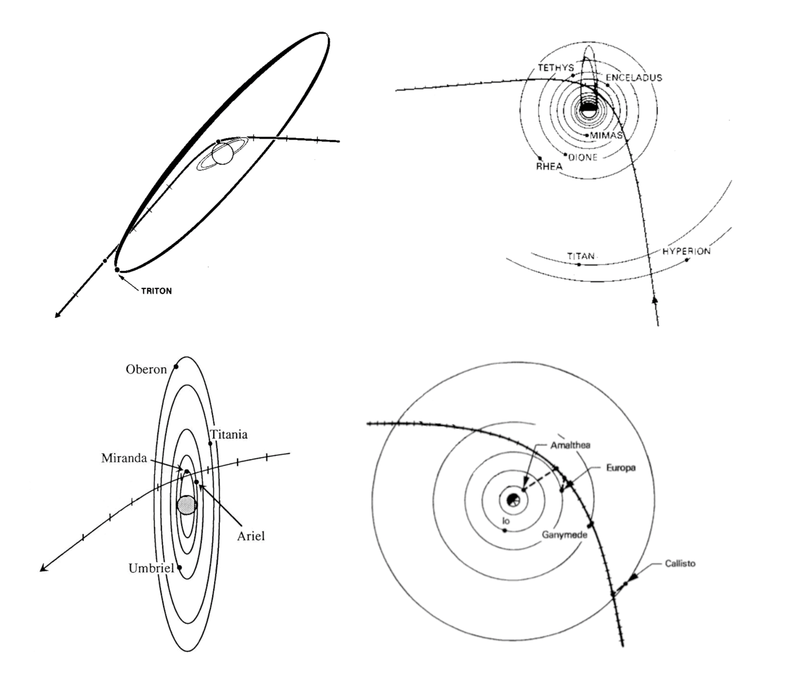
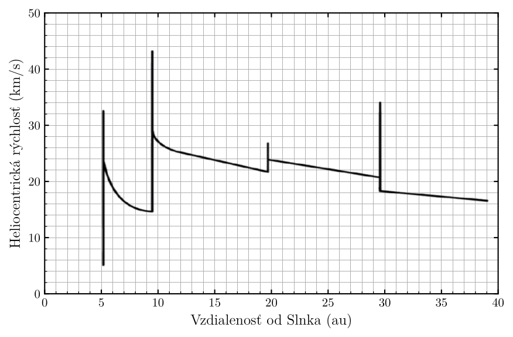
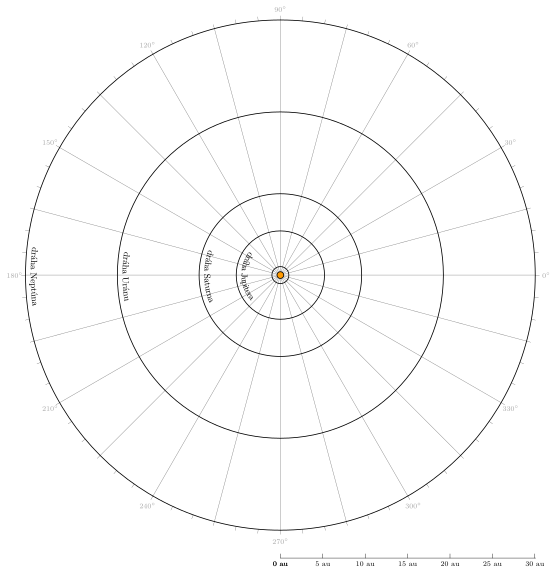
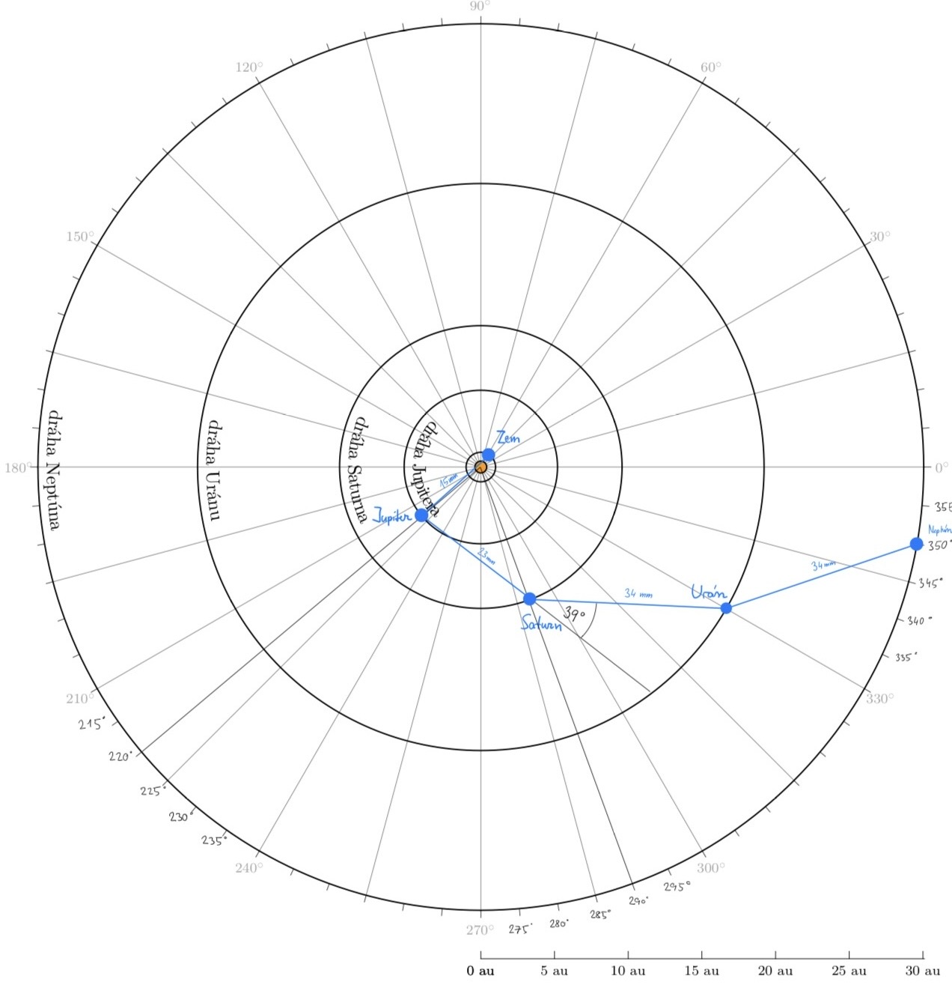

## Zadanie

20\. augusta 1977 bola vypustená medziplanetárna sonda Voyager 2. Prekvapivo, Voyager 1 bol vypustený až 5. septembra 1977, no v priebehu svojej dráhy predbehol Voyager 2. Obe sondy využili gravitačný manéver okolo veľkých plynných planét, ktoré im pomohli dosiahnuť vysokú rýchlosť, ktorou dnes putujú medzihviezdnym priestorom. Voyager 1 je rýchlejší, ale navštívil iba planéty Jupiter a Saturn, zatiaľ čo Voyager 2 navštívil ako prvá a dodnes jediná sonda okrem toho aj planéty Urán a Neptún.

<ol type="a">

<li>

[16 b] Na obrázku 1 vidíte 4 prelety sondy Voyager 2 okolo plynných planét. Vašou úlohou je identifikovať tieto planéty. V slnečnej sústave sa môžete zorientovať pomocou mesiacov plynných planét.

</li>

<li>

[4 b] Ktorá plynná planéta má najväčší sklon svojej osi rotácie voči ekliptike, a teda rotuje takpovediac „na boku“?

</li>

</ol>

<ol type="a">

<li>

[10 b] Z grafu na obrázku 2 odčítajte maximálnu rýchlosť sondy.

</li>

</ol>

<ol type="a">

<li>

[30 b] V tabuľke 1 nižšie sú zaznačené uhlové súradnice 4 plynných planét a Zeme v momente, kedy ich navštívila sonda Voyager 2. Vyznačte polohy planét do priloženého grafu. Taktiež načrtnite približnú trajektóriu sondy Voyager 2 medzi Zemou a Neptúnom. Budeme uvažovať kruhové orbity všetkých planét.

</li>

</ol>

**Tabuľka 1:** Uhlové súradnice planét pri preletoch sondy Voyager 2.

| Planéta | dátum preletu | uhlová súradnica |
|:-------:|--------------:|:----------------:|
|   Zem   | 20\. 08. 1977 |       60°        |
| Jupiter | 09\. 07. 1979 |       220°       |
| Saturn  | 26\. 08. 1981 |       290°       |
|  Urán   | 24\. 01. 1986 |       330°       |
| Neptún  | 25\. 08. 1989 |       350°       |

<ol type="a">

<li>

[40 b] Pomocou vami nakresleného obrázka vypočítajte priemernú rýchlosť sondy voči Slnku medzi Zemou a Neptúnom. Na zistenie a premenu vzdialeností medzi planétami využite mierku na obrázku.

</li>

</ol>

<ol type="a">

<li>

[20 b] Určte, o aký uhol sa vychýli Voyager 2 počas preletu popri Saturne. Môžete použiť uhlomer.

</li>

</ol>

<figure>

<figcaption>

**Obrázok 1:** Znázornenie preletov sondy Voyager 2 okolo plynných planét slnečnej sústavy.
</figcaption>

</figure>

<figure>

<figcaption>

**Obrázok 2:** Rýchlosť sondy Voyager 2 voči Slnku v období po prelete okolo Jupitera.
</figcaption>

</figure>

<figure>

<figcaption>

**Obrázok 3:** Znázornenie slnečnej sústavy a dráh planét spoločne s mierkou v astronomických jednotkách (au). Vyznačené sú dráhy plynných planét a Zeme.
</figcaption>

</figure>

Riešenie

<ol type="a">

<li>

Zľava doprava: Neptún a Saturn v prvom riadku, Urán a Jupiter v druhom riadku.[16 b] Najlepšie je na to ísť vylučovacou metódou: poznáme štyri veľké Galileove mesiace Io, Europa, Ganymede a Callisto, ktoré obiehajú okolo Jupitera. Ganymede je najväčším mesiacom v slnečnej sústave, zatiaľ čo Európa má obrovský podpovrchový oceán a smerujú k nemu sondy Europa Clipper (NASA) a JUICE (ESA). Io je z týchto štyroch mesiacov najbližšie k Jupiteru a je vulkanicky najaktívnejším telesom slnečnej sústavy vďaka extrémnemu slapovému pôsobeniu Jupitera.

Ďalej poznáme mesiace Titan a Enceladus pri Saturne. Titan je známy svojimi metánovými jazerami a veľmi hustou atmosférou, zatiaľ čo Enceladus je pokrytý čistým ľadom a podobne ako pri Europe sa odhaduje prítomnosť obrovského podpovrchového oceánu. K Titanu sa chystá lietajúca helikoptéra Dragonfly (NASA).

Keďže plynné planéty a veľké mesiace sú často pomenované podľa gréckej mytológie, môžno spojiť mesiac Triton s planétou Neptún. Triton je synom gréckeho boha mora Poseidona, teda Neptúna v rímskej kultúre.

Zostáva nám Urán, ktorý sa na svojej dráhe skoro „gúľa“. Jeho mesiace sú známe z hier od Williama Shakespeara, napríklad Titania je kráľovná víl z hry Sen noci svätojánskej.

</li>

<li>

Ide o planétu Urán, ktorej os rotácie je sklonená o 97,8°. Môžeme ho takto identifikovať aj v predošlej úlohe (a). [4 b]

</li>

<li>

Najväčšiu rýchlosť dosiahol Voyager približne $\boxed{43{,}5\,\mathrm{km}\,{\mathrm{s}}^{-1}}$, pri prelete okolo Saturna. [10 b]

</li>

<li>

Riešenie je znázornené na obrázku 4. Dané body môžeme pospájať čiarami a dostaneme približnú trajektóriu sondy Voyager 2. [30 b]

</li>

<li>

Priemernú rýchlosť vypočítame ako vzdialenosť Zeme a Neptúna pozdĺž trasy sondy predelenú celkovým časom letu. Trasa sa skladá z úsečiek medzi planétami, ktorých dĺžky nameriame pomocou pravítka a porovnáme ich s mierkou na obrázku. Konkrétne dĺžky závisia od formátu tlače, ale môžeme namerať napríklad nasledujúce hodnoty: 

$$
\begin{align*}
    \text{Zem -- Jupiter} \quad &\dots \quad 15\,\mathrm{mm}\,, \tag{1}\\
    \text{Jupiter -- Saturn} \quad &\dots \quad 23\,\mathrm{mm}\,, \tag{2}\\
    \text{Saturn -- Urán} \quad &\dots \quad 34\,\mathrm{mm}\,, \tag{3}\\
    \text{Urán -- Neptún} \quad &\dots \quad 34\,\mathrm{mm}\,. \tag{4}\end{align*}
$$

 Spolu je teda vzdialenosť približne $106\,\mathrm{mm}$. Pomocou mierky zistíme, že $75\,\mathrm{mm}$ zodpovedá v skutočnosti $30\,\mathrm{au}$, teda $106\,\mathrm{mm}$ bude 

$$
\frac{106\,\mathrm{mm}}{75\,\mathrm{mm}} \cdot 30\,\mathrm{au} = 42{,}4\,\mathrm{au} \,. \qquad\textit{[15\,b]} \tag{5}
$$

<figure>

<figcaption>

**Obrázok 4:** Znázornenie dráhy sondy Voyager 2.
</figcaption>

</figure>

Celkový čas medzi 20. 08. 1977 (štart zo Zeme) a 25. 08. 1989 (prelet pri Neptúne) bude niečo vyše 12 rokov. Každý nepriestupný rok má 365 dní a každý priestupný rok zas 366 dní. Priestupné roky boli v tomto časovom intervale tri, konkrétne 1980, 1984 a 1988. Rozdiel medzi dátumami 20. 08. a 25. 08. je päť dní. Dokopy uplynie 

$$
9 \cdot 365\,\mathrm{dní} + 3 \cdot 366\,\mathrm{dní} + 5\,\mathrm{dní} = 4388\,\mathrm{dní} \,. \qquad\textit{[15\,b]} \tag{6}
$$

 Priemerná rýchlosť je teda 

$$
v = \frac{42{,}4\,\mathrm{au}}{4388\,\mathrm{dní}} = \frac{42,4 \cdot 1{,}496 \cdot 10^{11}\,\mathrm{m}}{4388 \cdot 24 \cdot 3600\,\mathrm{s}} = 16\,731\,\mathrm{m}\,{\mathrm{s}}^{-1} \doteq \boxed{16{,}7\,\mathrm{km}\,{\mathrm{s}}^{-1}} \,, \qquad\textit{[10\,b]} \tag{7}
$$

 kde sme premenili astronomické jednotky na metre pomocou konštantovníka a dni na sekundy pomocou znalosti, že jeden deň má 24 hodín a jedna hodina má 3600 sekúnd.

Na získanie plného počtu bodov nie je potrebné presne spočítať počet dní, keďže chyba vo vzdialenosti z merania pravítkom bude omnoho väčšia ako chyba v čase. Pre približný výpočet postačuje spriemerovať dĺžku roka na $365{,}25\,\mathrm{dňa}$ a zanedbať rozdiel v dátumoch. Potom dostávame počet dní ako $12 \cdot 365{,}25\,\mathrm{dňa} = 4383\,\mathrm{dní}$ a rýchlosť ako $v = 16\,750\,\mathrm{m}\,{\mathrm{s}}^{-1}$. Výsledok sa líši iba o $0{,}019\,\mathrm{km}\,{\mathrm{s}}^{-1}$, čo predstavuje zanedbateľných $0,1\,\%$ hodnoty rýchlosti.

Nami vypočítaná rýchlosť je vyššia ako reálna rýchlosť Voyageru 2 po prelete okolo Neptúna. Tá je v realite približne $19\,\mathrm{km}\,{\mathrm{s}}^{-1}$, čo vieme vyčítať aj z grafu na obrázku 2. Dôležitý rozdiel spočíva v tom, že nami vypočítaná hodnota je priemerná rýchlosť za 12 rokov letu sondy. Skutočná rýchlosť bola niekedy vyššia a inokedy nižšia ako $16{,}7\,\mathrm{km}\,{\mathrm{s}}^{-1}$. Po prelete okolo Neptúna sa rýchlosť Voyageru 2 už len postupne znižovala kvôli gravitácii Slnka až na hodnotu $15{,}4\,\mathrm{km}\,{\mathrm{s}}^{-1}$ dnes.[^1]

</li>

<li>

Pomocou uhlomera možno odmerať uhol medzi úsečkou Saturn-Urán a polpriamkou Jupiter-Saturn. Dostaneme uhol vychýlenia sondy približne $39^{\circ}$. [20 b]

</li>

</ol>

[^1]: Rýchlosť a vzdialenosť Voyageru 1 a 2 viete sledovať napríklad na stránke <https://science.nasa.gov/mission/voyager/where-are-voyager-1-and-voyager-2-now/>.

