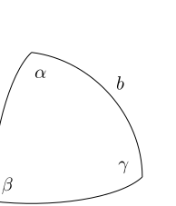

<table>
<tbody>
<tr>
<td colspan="4" style="text-align: left;"><strong>Základné fyzikálne konštanty</strong></td>
</tr>
<tr>
<td style="text-align: left;">Rýchlosť svetla vo vákuu</td>
<td style="text-align: right;">c</td>
<td style="text-align: center;">=</td>
<td style="text-align: left;">299\,792\,458\,\mathrm{m}\,{\mathrm{s}}^{-1}</td>
</tr>
<tr>
<td style="text-align: left;">Gravitačná konštanta</td>
<td style="text-align: right;">G</td>
<td style="text-align: center;">=</td>
<td style="text-align: left;">6{,}674 \cdot 10^{-11}\,{\mathrm{m}}^{3}\,{\mathrm{kg}}^{-1}\,{\mathrm{s}}^{-2}</td>
</tr>
<tr>
<td style="text-align: left;">Elementárny elektrický náboj</td>
<td style="text-align: right;">e</td>
<td style="text-align: center;">=</td>
<td style="text-align: left;">1{,}602 \cdot 10^{-19}\,\mathrm{C}</td>
</tr>
<tr>
<td style="text-align: left;">Planckova konštanta</td>
<td style="text-align: right;">h</td>
<td style="text-align: center;">=</td>
<td style="text-align: left;">6{,}626 \cdot 10^{-34}\,\mathrm{J}\,\mathrm{s}</td>
</tr>
<tr>
<td style="text-align: left;">Stefan-Boltzmannova konštanta</td>
<td style="text-align: right;">\sigma</td>
<td style="text-align: center;">=</td>
<td style="text-align: left;">5{,}670 \cdot 10^{-8}\,\mathrm{W}\,\mathrm{m}^{-2} \mathrm{K}^{-4}</td>
</tr>
<tr>
<td style="text-align: left;">Boltzmannova konštanta</td>
<td style="text-align: right;">k_\textrm{B}</td>
<td style="text-align: center;">=</td>
<td style="text-align: left;">1{,}381 \cdot 10^{-23}\,\mathrm{J}\,{\mathrm{K}}^{-1}</td>
</tr>
<tr>
<td style="text-align: left;">Wienova posunovacia konštanta</td>
<td style="text-align: right;">b</td>
<td style="text-align: center;">=</td>
<td style="text-align: left;">2{,}898 \cdot 10^{-3}\,\mathrm{m}\,\mathrm{K}</td>
</tr>
<tr>
<td style="text-align: left;">Hmotnosť elektrónu</td>
<td style="text-align: right;">m_\textrm{e}</td>
<td style="text-align: center;">=</td>
<td style="text-align: left;">9{,}109 \cdot 10^{-31}\,\mathrm{kg}</td>
</tr>
<tr>
<td style="text-align: left;">1 elektrónvolt</td>
<td style="text-align: right;">\eV</td>
<td style="text-align: center;">=</td>
<td style="text-align: left;">1{,}602 \cdot 10^{-19}\,\mathrm{J}</td>
</tr>
<tr>
<td style="text-align: left;">Atómová hmotnostná konštanta</td>
<td style="text-align: right;">m_{\rm{u}}</td>
<td style="text-align: center;">=</td>
<td style="text-align: left;">1{,}661 \cdot 10^{-27}\,\mathrm{kg} = 1 \mathrm{Da}</td>
</tr>
<tr>
<td style="text-align: left;"></td>
<td style="text-align: right;"></td>
<td style="text-align: center;"></td>
<td style="text-align: left;"></td>
</tr>
<tr>
<td colspan="4" style="text-align: left;"><strong>Astronomické konštanty</strong></td>
</tr>
<tr>
<td style="text-align: left;">1 deň (stredný slnečný)</td>
<td style="text-align: right;"></td>
<td style="text-align: center;">=</td>
<td style="text-align: left;">24\,\mathrm{h}</td>
</tr>
<tr>
<td style="text-align: left;">1 siderický deň</td>
<td style="text-align: right;"></td>
<td style="text-align: center;">=</td>
<td style="text-align: left;">23^{\mathrm{h}}\,56^{\mathrm{min}}\,4{,}1^{\mathrm{s}}</td>
</tr>
<tr>
<td style="text-align: left;">1 tropický rok</td>
<td style="text-align: right;"></td>
<td style="text-align: center;">=</td>
<td style="text-align: left;">365{,}2422\,\mathrm{dní}</td>
</tr>
<tr>
<td style="text-align: left;">1 siderický rok</td>
<td style="text-align: right;"></td>
<td style="text-align: center;">=</td>
<td style="text-align: left;">365{,}2564\,\mathrm{dní}</td>
</tr>
<tr>
<td style="text-align: left;">1 anomalistický rok</td>
<td style="text-align: right;"></td>
<td style="text-align: center;">=</td>
<td style="text-align: left;">365{,}2596\,\mathrm{dní}</td>
</tr>
<tr>
<td style="text-align: left;">1 astronomická jednotka</td>
<td style="text-align: right;">\au</td>
<td style="text-align: center;">=</td>
<td style="text-align: left;">149\,597\,870\,700\,\mathrm{m}</td>
</tr>
<tr>
<td style="text-align: left;">1 svetelný rok</td>
<td style="text-align: right;">\ly</td>
<td style="text-align: center;">=</td>
<td style="text-align: left;">9{,}461 \cdot 10^{15}\,\mathrm{m}</td>
</tr>
<tr>
<td style="text-align: left;"></td>
<td style="text-align: right;"></td>
<td style="text-align: center;">=</td>
<td style="text-align: left;">63\,240\,\mathrm{au}</td>
</tr>
<tr>
<td style="text-align: left;">1 parsek</td>
<td style="text-align: right;">\pc</td>
<td style="text-align: center;">=</td>
<td style="text-align: left;">3{,}086 \cdot 10^{16}\,\mathrm{m}</td>
</tr>
<tr>
<td style="text-align: left;"></td>
<td style="text-align: right;"></td>
<td style="text-align: center;">=</td>
<td style="text-align: left;">360/(2\pi) \cdot 60^2 \, \au</td>
</tr>
<tr>
<td style="text-align: left;"></td>
<td style="text-align: right;"></td>
<td style="text-align: center;">=</td>
<td style="text-align: left;">3{,}262\,\mathrm{ly}</td>
</tr>
<tr>
<td style="text-align: left;">Vzdialenosť ku galaktickému centru</td>
<td style="text-align: right;">d_\textrm{GC}</td>
<td style="text-align: center;">=</td>
<td style="text-align: left;">8,18(3)\,\mathrm{kpc}</td>
</tr>
<tr>
<td style="text-align: left;">Hubblova konštanta</td>
<td style="text-align: right;">H_0</td>
<td style="text-align: center;">=</td>
<td style="text-align: left;">73\,\mathrm{km} \, \mathrm{s}^{-1} \mathrm{Mpc}^{-1}</td>
</tr>
<tr>
<td style="text-align: left;">1 jansky</td>
<td style="text-align: right;">Jy</td>
<td style="text-align: center;">=</td>
<td style="text-align: left;">10^{-26}\,\mathrm{W}\,{\mathrm{m}}^{-2}\,{\mathrm{Hz}}^{-1}</td>
</tr>
<tr>
<td style="text-align: left;">Vek vesmíru</td>
<td style="text-align: right;">t_0</td>
<td style="text-align: center;">=</td>
<td style="text-align: left;">13{,}8 \cdot 10^{9}\,\mathrm{rokov}</td>
</tr>
<tr>
<td style="text-align: left;"></td>
<td style="text-align: right;"></td>
<td style="text-align: center;"></td>
<td style="text-align: left;"></td>
</tr>
<tr>
<td colspan="4" style="text-align: left;"><strong>Ďalšie konštanty</strong></td>
</tr>
<tr>
<td style="text-align: left;">hmotnosť elektrónu</td>
<td style="text-align: right;"></td>
<td style="text-align: center;">=</td>
<td style="text-align: left;">0{,}511\,\mathrm{MeV}\,{\mathit{c}}^{-2}</td>
</tr>
<tr>
<td style="text-align: left;">hmotnosť ^1H</td>
<td style="text-align: right;"></td>
<td style="text-align: center;">=</td>
<td style="text-align: left;">938{,}27\,\mathrm{MeV}\,{\mathit{c}}^{-2}</td>
</tr>
<tr>
<td style="text-align: left;">hmotnosť ^2H</td>
<td style="text-align: right;"></td>
<td style="text-align: center;">=</td>
<td style="text-align: left;">1875{,}6\,\mathrm{MeV}\,{\mathit{c}}^{-2}</td>
</tr>
<tr>
<td style="text-align: left;">hmotnosť ^3He</td>
<td style="text-align: right;"></td>
<td style="text-align: center;">=</td>
<td style="text-align: left;">2808{,}3\,\mathrm{MeV}\,{\mathit{c}}^{-2}</td>
</tr>
<tr>
<td style="text-align: left;">hmotnosť ^4He</td>
<td style="text-align: right;"></td>
<td style="text-align: center;">=</td>
<td style="text-align: left;">3727{,}4\,\mathrm{MeV}\,{\mathit{c}}^{-2}</td>
</tr>
<tr>
<td style="text-align: left;">jednotka hmotnosti častíc</td>
<td style="text-align: right;">1\,\mathrm{MeV}\,{\mathit{c}}^{-2}</td>
<td style="text-align: center;">=</td>
<td style="text-align: left;">1{,}783 \cdot 10^{-30}\,\mathrm{kg}</td>
</tr>
<tr>
<td style="text-align: left;"><strong>Sférické vzťahy</strong></td>
<td colspan="3" rowspan="7" style="text-align: center;"></td>
</tr>
<tr>
<td style="text-align: left;"></td>
</tr>
<tr>
<td style="text-align: left;"></td>
</tr>
<tr>
<td style="text-align: left;"></td>
</tr>
<tr>
<td style="text-align: left;"></td>
</tr>
<tr>
<td style="text-align: left;"><strong>Slnko (\Sun)</strong></td>
</tr>
<tr>
<td style="text-align: left;">Hmotnosť</td>
</tr>
<tr>
<td style="text-align: left;">Polomer</td>
<td style="text-align: right;">R_\Sun</td>
<td style="text-align: center;">=</td>
<td style="text-align: left;">6{,}955 \cdot 10^{8}\,\mathrm{m}</td>
</tr>
<tr>
<td style="text-align: left;">Žiarivý výkon (svietivosť)</td>
<td style="text-align: right;">L_\Sun</td>
<td style="text-align: center;">=</td>
<td style="text-align: left;">3{,}826 \cdot 10^{26}\,\mathrm{W}</td>
</tr>
<tr>
<td style="text-align: left;">Solárna konštanta (vo vzdialenosti Zeme)</td>
<td style="text-align: right;">S</td>
<td style="text-align: center;">=</td>
<td style="text-align: left;">1366\,\mathrm{W}\,\mathrm{m}^{-2}</td>
</tr>
<tr>
<td style="text-align: left;">Povrchová teplota</td>
<td style="text-align: right;">T_\Sun</td>
<td style="text-align: center;">=</td>
<td style="text-align: left;">5778\,\mathrm{K}</td>
</tr>
<tr>
<td style="text-align: left;">Zdanlivá vizuálna magnitúda</td>
<td style="text-align: right;">m_\Sun</td>
<td style="text-align: center;">=</td>
<td style="text-align: left;">-26{,}72</td>
</tr>
<tr>
<td style="text-align: left;">Absolútna vizuálna magnitúda</td>
<td style="text-align: right;">M_{\Sun,\textrm{V}}</td>
<td style="text-align: center;">=</td>
<td style="text-align: left;">4{,}82</td>
</tr>
<tr>
<td style="text-align: left;">Absolútna bolometrická magnitúda</td>
<td style="text-align: right;">M_{\Sun,\textrm{bol}}</td>
<td style="text-align: center;">=</td>
<td style="text-align: left;">4{,}72</td>
</tr>
<tr>
<td style="text-align: left;">Rotačná perióda na rovníku</td>
<td style="text-align: right;">P_\Sun</td>
<td style="text-align: center;">=</td>
<td style="text-align: left;">25{,}4\,\mathrm{dní}</td>
</tr>
<tr>
<td style="text-align: left;"></td>
<td style="text-align: right;"></td>
<td style="text-align: center;"></td>
<td style="text-align: left;"></td>
</tr>
<tr>
<td style="text-align: left;"><strong>Merkúr (\Me)</strong></td>
<td style="text-align: right;"></td>
<td style="text-align: center;"></td>
<td style="text-align: left;"></td>
</tr>
<tr>
<td style="text-align: left;">Hmotnosť</td>
<td style="text-align: right;">M_{\Me}</td>
<td style="text-align: center;">=</td>
<td style="text-align: left;">3{,}3022 \cdot 10^{23}\,\mathrm{kg}</td>
</tr>
<tr>
<td style="text-align: left;">Polomer</td>
<td style="text-align: right;">R_{\Me}</td>
<td style="text-align: center;">=</td>
<td style="text-align: left;">2440\,\mathrm{km}</td>
</tr>
<tr>
<td style="text-align: left;">Veľká polos</td>
<td style="text-align: right;">a_{\Me}</td>
<td style="text-align: center;">=</td>
<td style="text-align: left;">0{,}387\,\mathrm{au}</td>
</tr>
<tr>
<td style="text-align: left;"></td>
<td style="text-align: right;"></td>
<td style="text-align: center;"></td>
<td style="text-align: left;"></td>
</tr>
<tr>
<td style="text-align: left;"><strong>Venuša (\Ve)</strong></td>
<td style="text-align: right;"></td>
<td style="text-align: center;"></td>
<td style="text-align: left;"></td>
</tr>
<tr>
<td style="text-align: left;">Hmotnosť</td>
<td style="text-align: right;">M_{\Ve}</td>
<td style="text-align: center;">=</td>
<td style="text-align: left;">4{,}8673 \cdot 10^{24}\,\mathrm{kg}</td>
</tr>
<tr>
<td style="text-align: left;">Polomer</td>
<td style="text-align: right;">R_{\Ve}</td>
<td style="text-align: center;">=</td>
<td style="text-align: left;">6052\,\mathrm{km}</td>
</tr>
<tr>
<td style="text-align: left;">Veľká polos</td>
<td style="text-align: right;">a_{\Ve}</td>
<td style="text-align: center;">=</td>
<td style="text-align: left;">0{,}723\,\mathrm{au}</td>
</tr>
<tr>
<td style="text-align: left;"></td>
<td style="text-align: right;"></td>
<td style="text-align: center;"></td>
<td style="text-align: left;"></td>
</tr>
<tr>
<td style="text-align: left;"><strong>Zem (\Ea)</strong></td>
<td style="text-align: right;"></td>
<td style="text-align: center;"></td>
<td style="text-align: left;"></td>
</tr>
<tr>
<td style="text-align: left;">Hmotnosť</td>
<td style="text-align: right;">M_\Ea</td>
<td style="text-align: center;">=</td>
<td style="text-align: left;">5{,}9736 \cdot 10^{24}\,\mathrm{kg}</td>
</tr>
<tr>
<td style="text-align: left;">Polomer</td>
<td style="text-align: right;">R_\Ea</td>
<td style="text-align: center;">=</td>
<td style="text-align: left;">6378\,\mathrm{km}</td>
</tr>
<tr>
<td style="text-align: left;">Veľká polos</td>
<td style="text-align: right;">a_\Ea</td>
<td style="text-align: center;">=</td>
<td style="text-align: left;">1\,\mathrm{au}</td>
</tr>
<tr>
<td style="text-align: left;">Inklinácia rotačnej osi</td>
<td style="text-align: right;">\epsilon</td>
<td style="text-align: center;">=</td>
<td style="text-align: left;">23^{\circ}\,26'</td>
</tr>
<tr>
<td style="text-align: left;">Excentricita</td>
<td style="text-align: right;">e_\Ea</td>
<td style="text-align: center;">=</td>
<td style="text-align: left;">0{,}0167</td>
</tr>
<tr>
<td style="text-align: left;">Tiažové zrýchlenie</td>
<td style="text-align: right;">g</td>
<td style="text-align: center;">=</td>
<td style="text-align: left;">9{,}8\,\mathrm{m}\,{\mathrm{s}}^{-2}</td>
</tr>
<tr>
<td style="text-align: left;"></td>
<td style="text-align: right;"></td>
<td style="text-align: center;"></td>
<td style="text-align: left;"></td>
</tr>
<tr>
<td style="text-align: left;"><strong>Mesiac (\Mo)</strong></td>
<td style="text-align: right;"></td>
<td style="text-align: center;"></td>
<td style="text-align: left;"></td>
</tr>
<tr>
<td style="text-align: left;">Hmotnosť</td>
<td style="text-align: right;">M_\Mo</td>
<td style="text-align: center;">=</td>
<td style="text-align: left;">7{,}4377 \cdot 10^{22}\,\mathrm{kg}</td>
</tr>
<tr>
<td style="text-align: left;">Polomer</td>
<td style="text-align: right;">R_\Mo</td>
<td style="text-align: center;">=</td>
<td style="text-align: left;">1{,}7374 \cdot 10^{6}\,\mathrm{m}</td>
</tr>
<tr>
<td style="text-align: left;">Priemerná vzdialenosť od Zeme</td>
<td style="text-align: right;">a_\Mo</td>
<td style="text-align: center;">=</td>
<td style="text-align: left;">3{,}844 \cdot 10^{8}\,\mathrm{m}</td>
</tr>
<tr>
<td style="text-align: left;">Zdanlivá vizuálna magnitúda v splne</td>
<td style="text-align: right;">m_\Mo</td>
<td style="text-align: center;">=</td>
<td style="text-align: left;">-12{,}74</td>
</tr>
<tr>
<td style="text-align: left;">Siderická perióda</td>
<td style="text-align: right;">P_{\Mo,\textrm{si}}</td>
<td style="text-align: center;">=</td>
<td style="text-align: left;">27{,}3217\,\mathrm{dní}</td>
</tr>
<tr>
<td style="text-align: left;">Synodická perióda</td>
<td style="text-align: right;">P_{\Mo,\textrm{sy}}</td>
<td style="text-align: center;">=</td>
<td style="text-align: left;">29{,}5306\,\mathrm{dní}</td>
</tr>
<tr>
<td style="text-align: left;">Inlinácia orbity voči ekliptike</td>
<td style="text-align: right;">i_\Mo</td>
<td style="text-align: center;">=</td>
<td style="text-align: left;">5{,}14^{\circ}</td>
</tr>
<tr>
<td style="text-align: left;">Excentricita</td>
<td style="text-align: right;">e_\Mo</td>
<td style="text-align: center;">=</td>
<td style="text-align: left;">0{,}0549</td>
</tr>
<tr>
<td style="text-align: left;"></td>
<td style="text-align: right;"></td>
<td style="text-align: center;"></td>
<td style="text-align: left;"></td>
</tr>
<tr>
<td style="text-align: left;"><strong>Mars (\Ma)</strong></td>
<td style="text-align: right;"></td>
<td style="text-align: center;"></td>
<td style="text-align: left;"></td>
</tr>
<tr>
<td style="text-align: left;">Hmotnosť</td>
<td style="text-align: right;">M_\Ma</td>
<td style="text-align: center;">=</td>
<td style="text-align: left;">6{,}4169 \cdot 10^{23}\,\mathrm{kg}</td>
</tr>
<tr>
<td style="text-align: left;">Polomer</td>
<td style="text-align: right;">R_\Ma</td>
<td style="text-align: center;">=</td>
<td style="text-align: left;">3393\,\mathrm{km}</td>
</tr>
<tr>
<td style="text-align: left;">Veľká polos</td>
<td style="text-align: right;">a_\Ma</td>
<td style="text-align: center;">=</td>
<td style="text-align: left;">1{,}524\,\mathrm{au}</td>
</tr>
<tr>
<td style="text-align: left;"></td>
<td style="text-align: right;"></td>
<td style="text-align: center;"></td>
<td style="text-align: left;"></td>
</tr>
<tr>
<td style="text-align: left;"><strong>Jupiter (\Ju)</strong></td>
<td style="text-align: right;"></td>
<td style="text-align: center;"></td>
<td style="text-align: left;"></td>
</tr>
<tr>
<td style="text-align: left;">Hmotnosť</td>
<td style="text-align: right;">M_\Ju</td>
<td style="text-align: center;">=</td>
<td style="text-align: left;">1{,}8981 \cdot 10^{27}\,\mathrm{kg}</td>
</tr>
<tr>
<td style="text-align: left;">Polomer</td>
<td style="text-align: right;">R_{\Ju}</td>
<td style="text-align: center;">=</td>
<td style="text-align: left;">69\,911\,\mathrm{km}</td>
</tr>
<tr>
<td style="text-align: left;">Veľká polos</td>
<td style="text-align: right;">a_{\Ju}</td>
<td style="text-align: center;">=</td>
<td style="text-align: left;">5{,}204\,\mathrm{au}</td>
</tr>
<tr>
<td style="text-align: left;"></td>
<td style="text-align: right;"></td>
<td style="text-align: center;"></td>
<td style="text-align: left;"></td>
</tr>
<tr>
<td style="text-align: left;"><strong>Saturn (\Sa)</strong></td>
<td style="text-align: right;"></td>
<td style="text-align: center;"></td>
<td style="text-align: left;"></td>
</tr>
<tr>
<td style="text-align: left;">Hmotnosť</td>
<td style="text-align: right;">M_{\Sa}</td>
<td style="text-align: center;">=</td>
<td style="text-align: left;">5{,}6834 \cdot 10^{26}\,\mathrm{kg}</td>
</tr>
<tr>
<td style="text-align: left;">Polomer</td>
<td style="text-align: right;">R_{\Sa}</td>
<td style="text-align: center;">=</td>
<td style="text-align: left;">58\,232\,\mathrm{km}</td>
</tr>
<tr>
<td style="text-align: left;">Veľká polos</td>
<td style="text-align: right;">a_{\Sa}</td>
<td style="text-align: center;">=</td>
<td style="text-align: left;">9{,}583\,\mathrm{au}</td>
</tr>
<tr>
<td style="text-align: left;"></td>
<td style="text-align: right;"></td>
<td style="text-align: center;"></td>
<td style="text-align: left;"></td>
</tr>
<tr>
<td style="text-align: left;"><strong>Urán (\Ur)</strong></td>
<td style="text-align: right;"></td>
<td style="text-align: center;"></td>
<td style="text-align: left;"></td>
</tr>
<tr>
<td style="text-align: left;">Hmotnosť</td>
<td style="text-align: right;">M_{\Ur}</td>
<td style="text-align: center;">=</td>
<td style="text-align: left;">8{,}6810 \cdot 10^{25}\,\mathrm{kg}</td>
</tr>
<tr>
<td style="text-align: left;">Polomer</td>
<td style="text-align: right;">R_{\Ur}</td>
<td style="text-align: center;">=</td>
<td style="text-align: left;">25\,362\,\mathrm{km}</td>
</tr>
<tr>
<td style="text-align: left;">Veľká polos</td>
<td style="text-align: right;">a_{\Ur}</td>
<td style="text-align: center;">=</td>
<td style="text-align: left;">19{,}191\,\mathrm{au}</td>
</tr>
<tr>
<td style="text-align: left;"></td>
<td style="text-align: right;"></td>
<td style="text-align: center;"></td>
<td style="text-align: left;"></td>
</tr>
<tr>
<td style="text-align: left;"><strong>Neptún (\Ne)</strong></td>
<td style="text-align: right;"></td>
<td style="text-align: center;"></td>
<td style="text-align: left;"></td>
</tr>
<tr>
<td style="text-align: left;">Hmotnosť</td>
<td style="text-align: right;">M_{\Ne}</td>
<td style="text-align: center;">=</td>
<td style="text-align: left;">1{,}0241 \cdot 10^{26}\,\mathrm{kg}</td>
</tr>
<tr>
<td style="text-align: left;">Polomer</td>
<td style="text-align: right;">R_{\Ne}</td>
<td style="text-align: center;">=</td>
<td style="text-align: left;">24\,764\,\mathrm{km}</td>
</tr>
<tr>
<td style="text-align: left;">Veľká polos</td>
<td style="text-align: right;">a_{\Ne}</td>
<td style="text-align: center;">=</td>
<td style="text-align: left;">30{,}07\,\mathrm{au}</td>
</tr>
<tr>
<td style="text-align: left;"></td>
<td style="text-align: right;"></td>
<td style="text-align: center;"></td>
<td style="text-align: left;"></td>
</tr>
<tr>
<td style="text-align: left;"><strong>Pluto (\Pl)</strong></td>
<td style="text-align: right;"></td>
<td style="text-align: center;"></td>
<td style="text-align: left;"></td>
</tr>
<tr>
<td style="text-align: left;">Hmotnosť</td>
<td style="text-align: right;">M_{\Pl}</td>
<td style="text-align: center;">=</td>
<td style="text-align: left;">1{,}305 \cdot 10^{22}\,\mathrm{kg}</td>
</tr>
<tr>
<td style="text-align: left;">Polomer</td>
<td style="text-align: right;">R_{\Pl}</td>
<td style="text-align: center;">=</td>
<td style="text-align: left;">2370\,\mathrm{km}</td>
</tr>
<tr>
<td style="text-align: left;">Veľká polos</td>
<td style="text-align: right;">a_{\Pl}</td>
<td style="text-align: center;">=</td>
<td style="text-align: left;">39{,}481\,\mathrm{au}</td>
</tr>
</tbody>
</table>
